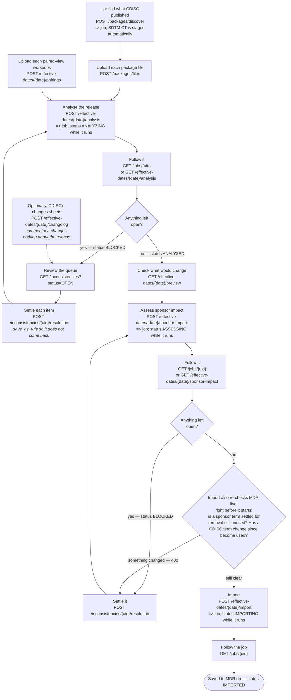
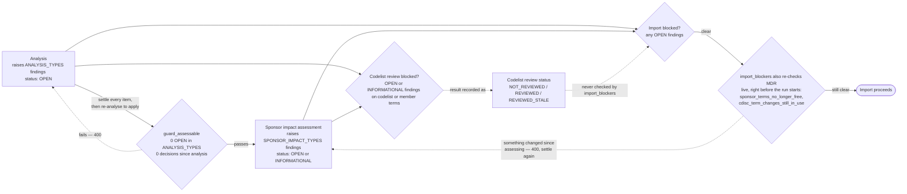
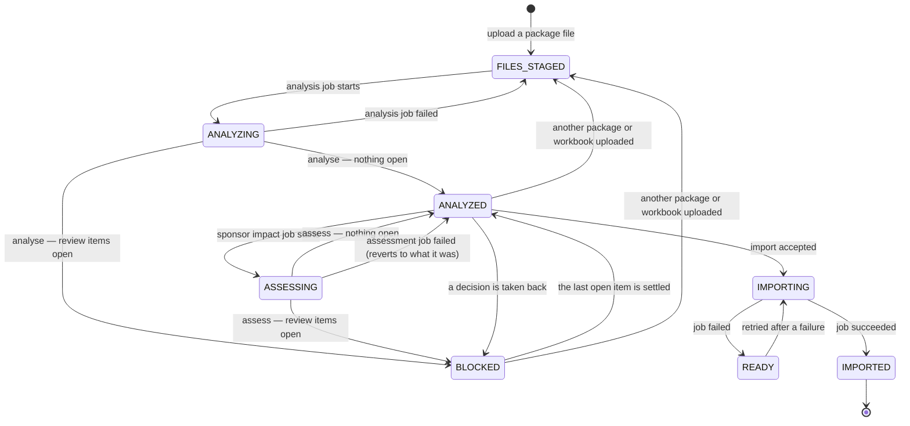

# Standards Import API

Ingests CDISC controlled terminology packages into OpenStudyBuilder over HTTP, replacing
the hand-run Cypher scripts in `import_standards/` for **new** releases.

Shares `common/` with the other three apps.

## Why it is a separate app

Two reasons, both structural rather than stylistic:

- **Two databases.** neomodel's connection is process-global and bound to the MDR
  database. The CDISC staging graph can be split off into a second Neo4j database.
  Regardless of setup, it is reached with the raw driver, and no other app should
  carry a dependency on it.
- **It writes around the domain guards.** The main API refuses to create codelists or
  terms in the non-editable `CDISC` library, enforces global name and submission-value
  uniqueness, and stamps every `HAS_VERSION.start_date` with the server clock. CDISC
  content violates all three by nature. Keeping that bypass in a separately deployed app
  with its own `Library.Import` role leaves the main API's guarantees intact.

The routers are served by the main app on port 8000 under `/standards-import` (when
`STANDARDS_IMPORT_ENABLED=true`), but the `standards_import` Python package stays 
a **separate top-level module tree** — not merged into `clinical_mdr_api`. Two enforcement
tools depend on this:
- the **import-linter** `independence` contract (`clinical_mdr_api ↔ standards_import`),
  enforced by `pipenv run lint-imports` in CI;
- the **sblint** Cypher linter that flags a CREATE/MERGE in a Cypher string that uses a
  staging label without `:CDISCStaging` alongside it.

Collapsing the namespace would break both, removing the principal static check that a
staging write path can't silently leak into the MDR graph.

Note this app can also run as a standalone API on port 8010 with `pipenv run standards-import-dev`,
in which case set `STANDARDS_IMPORT_ENABLED=false` on the main app.

**Every staging node carries `:CDISCStaging` as a second label** (e.g.
`CREATE (p:RawPackage:CDISCStaging {...})`). This is what lets Neo4j RBAC, the
verifications drift-check (`verifications/tests/test_db_staging_isolation.py`), and the
sblint rule all enforce isolation independently:
- The `mdr` Neo4j role has a DENY on `:CDISCStaging` nodes; the `staging` role is an
  allowlist of `:CDISCStaging` only. These are **defence in depth** — the app must work
  on Community edition or with unprovisioned roles. Nothing in the code relies on the DENY
  being active; it is a runtime enforcement layer on top of the static ones.
- `mdr_repository.py` must never create nodes with `:CDISCStaging` — its module docstring
  says so explicitly.

**`Library.Import` gates every route, the reads included.** No role granted elsewhere in
OSB opens anything here — not `Admin.Read`, which admits the read-only views of the main
API. Reading here is the review queue and the staged contents of a release nobody has
imported yet: working material for whoever is running the import, and of no use to a
general reader.

**A consequence worth knowing before reading `repositories/`: the staging repositories
are hand-written Cypher on the raw driver, not neomodel.** The staging model is working data
rather than domain aggregates — the work is set-based, grouping thousands of raw codelists
across catalogues and comparing them property by property, which is a few large queries
rather than hydrating objects one at a time. This is also lets the driver target a separate
database if desired.

The split is clean: every repository takes a `StagingSession` (a `NewType` of
`neo4j.Session`, issued only by `staging_db.staging_session()`) and queries with the
`staging` user, except `mdr_repository`, which is the only one that touches OSB and so goes
through neomodel's connection (`db.cypher_query`) — still Cypher, but on the MDR binding.

## How it works, end to end

A CDISC quarterly release is a set of catalogue files sharing one effective date, plus
the paired-codelist workbooks that say which codelists belong together. You upload them,
the service works out what disagrees, you settle whatever it cannot settle itself, and
then it applies the release to OSB.



Analysis, sponsor impact assessment, import and discovery are all jobs: each `POST`
returns `202` immediately with a `Job` (`uid`, `kind`, `status`), and the work itself runs
in the background. Follow it with `GET /jobs/{uid}`, or — for analysis and sponsor
impact — with the release-scoped `GET` that reads the outcome once the job succeeds. At
most one of these can be running against a given release at a time; starting a second
while one is already `RUNNING` is refused, naming what is running. Discovery is the one
exception with no release to scope to, so its own guard is global: one discovery run at a
time, full stop.

The loop between analysis and review is the heart of it, and the arrow from review back
to analysis is not optional. **Posting a resolution records the decision; it does not
touch the staged values.** The decision is applied to the grouped concept by the *next*
analysis run, so after settling a batch of items you re-run
`POST /effective-dates/{date}/analysis` to have those choices take effect. Until you do,
the staged value is still the one CDISC shipped.

This is worth being precise about, because the status alone will not tell you. Settling
an item updates the release's open count immediately, so resolving the last one flips it
from `BLOCKED` to `ANALYZED` there and then — while the staged values are still
unchanged. The import is what enforces the difference: it refuses a release with
decisions newer than its last analysis run, naming how many. So `ANALYZED` means
"nothing is open", not "staging is up to date"; only an analysis run makes it both.

Re-analysing is safe and cheap to repeat: decisions already made are kept and reattached,
and are only discarded — reopening the item — if the values they were made about have
changed since.

Everything up to the import writes only to the **staging** graph. Nothing reaches mdr graph
until you ask for the import, and the import refuses a release with anything still open.

### Sponsor impact assessment

The preview answers "what does this release change in CDISC terms?". The step after it
answers the question the preview cannot: **what does it mean for what the sponsor has
already built?**

```
POST /effective-dates/2026-03-27/sponsor-impact
```

It reads the sponsor side of the OSB database — every library other than `CDISC` — and
raises a review item for each of four things:

| Kind | Raised when |
|---|---|
| `SPONSOR_TERM_DUPLICATE` | A term this release adds to a codelist means the same as a sponsor term already in it |
| `SPONSOR_CODELIST_DUPLICATE` | A codelist this release introduces covers the same ground as a sponsor codelist |
| `SPONSOR_TERM_SEMANTIC_DUPLICATE` | A language model flags an added term as meaning the same as a sponsor term under a different name |
| `SPONSOR_NAME_DIVERGED` | CDISC has changed a term whose sponsor name is no longer what the naming rules would produce |

It also asks a different question of the **CDISC** side — see "CDISC changes that land
on downstream usage" below, which raises two more kinds.

They join the same queue as everything else and are settled through
`POST /inconsistencies/{uid}/resolution`, with the same rules, the same durability, and
the same deterministic uids. This is not a second review system.

**The assessment is not optional.** The import refuses a release that has not been
assessed, and refuses one analysed since it was — because analysis rebuilds the values
the assessment compared against. `assessed_at` on `GET /effective-dates/{date}` is what
to check against its `analyzed_at`.

#### Why a term duplicate is the tricky one

The main API requires a term's name to be unique among the terms of the codelists it
belongs to, and a codelist's name and submission value to be unique outright. **Nothing
in this app's Cypher enforces either** — it writes around the domain aggregates by
design. So a CDISC term arriving with the name of a sponsor term already in that codelist
imports perfectly quietly, and leaves a codelist the main API then refuses to edit.

That is why collisions are graded, and the grade is a `match_tier`:

| `match_tier` | Means | Shipped behaviour |
|---|---|---|
| `EXACT` | The values are identical | **Left open**, status `OPEN`. It has to be settled before the release goes in |
| `CASE_INSENSITIVE` | They differ only in case | Raised at status `INFORMATIONAL`; never blocking |
| `NORMALIZED` | They differ only in spacing or punctuation | Raised at status `INFORMATIONAL`; never blocking |

Only `EXACT` breaks a rule. The other two imply two concepts now mean the same thing under
different spellings, which is a data-quality call rather than a stop-the-import event —
`SEV` and `sev` are genuinely different submission values. So the two tiers do not just
get a different **decision** by default, they get a different **status**: an `EXACT`
collision is `OPEN` and stays that way until settled; anything looser is `INFORMATIONAL`
from the moment it is raised and never blocks the import at all, acknowledged or not.

`INFORMATIONAL` is not a milder flavour of `OPEN` waiting on a rule — it is raised
directly at that status by the assessment itself, and nothing settles it automatically.
The only thing that moves it forward is a person, through `ACKNOWLEDGE` (see "What can be
done about one" below). This is a deliberate choice about what a queue should show: a
collision an organisation genuinely never wants surfaced is one they filter out of what
they look at, not one this app quietly decides on their behalf and hides the evidence of.

#### What it compares, and why that is not the CDISC preferred term

The name a term will actually be called in MDR is what the `SPONSOR_NAME` review item
settled — the shipped rules turn `Interventional Study` into `Interventional` across
dozens of codelists — or, for a term MDR already holds, the name already there, which the
import never overwrites. Comparing CDISC's own `preferredTerm` would both miss real
collisions and invent ones that could never happen.

That is also why the assessment runs on a release with **nothing else open**: until every
naming item is settled, the name to compare has not been chosen. It refuses one that is
still `BLOCKED` by an analysis finding, and one whose decisions have not been applied by
a re-analysis.

`SPONSOR_NAME_DIVERGED` works the same way from the other end, and it takes **two**
comparisons rather than one. It does not compare the stored name against `preferredTerm` —
that differs for every rule-covered codelist and would report all of them forever. It
re-runs the naming rules against what CDISC now ships, and reports only where the answer
has moved away from what MDR holds **and** where re-running them against what CDISC
shipped *before* would have given a different answer.

That second comparison is what makes the finding mean what its name says. A term's name in
MDR differing from what the rules produce is common and says nothing about this release: on
a database the bootstrap script populated, thousands of terms carry a name no rule would
produce today — every Trial Phase term is called `Phase 0 Trial` rather than
`Early Phase 1`, for instance. Reporting each of those the moment CDISC reworded its
definition would bury the handful where a rename actually happened. What is reported is a
name **this release moved**.

Such a finding carries two candidates, and each says which name it is. `catalogues` is the
provenance of a value CDISC shipped; for a value that came from somewhere else, `source`
says where:

```json
"candidates": [
  {"value": "A Name Of Our Own", "catalogues": [],
   "source": "sponsor preferred name currently held in MDR"},
  {"value": "New Name", "catalogues": ["SDTM CT 2026-03-27"],
   "source": "naming rules applied to the CDISC preferred term"}
]
```

Read them by `source`, never by position. The one from the rules also carries the CDISC
catalogues that shipped the preferred term it was produced from, which is what says which
package moved the name. A semantic candidate says the same way that it came from a
language model, and which one.

#### What can be done about one

| Strategy | Applies to | What the import then does |
|---|---|---|
| `ACKNOWLEDGE` | all three | Nothing. Confirms this has been looked at and settles the item as `ACKNOWLEDGED` |
| `REMOVE_SPONSOR_FROM_CODELIST` | term duplicate | Closes the sponsor term's membership of that codelist |
| `RETIRE_SPONSOR_TERM` | term duplicate | Retires the sponsor term, both halves, **and** closes that membership |
| `ADOPT_CDISC_NAME` | diverged name | Opens a new name version carrying what the rules produce today |

`ACKNOWLEDGE` rather than `IGNORE`, for these three and for `SPONSOR_CODELIST_DUPLICATE`
below: what it settles is not a data disagreement being waved through — the values are
already agreed on, it is the finding itself (a near-duplicate, a diverged name, an
overlapping codelist) that has been considered and accepted. `IGNORE` does not apply to
any of the four sponsor-impact kinds at all; asking for it is refused, naming the menu.
`ACKNOWLEDGE` can never be saved as a rule, on any of the four: what it settles is a fact
about today's database — this near-duplicate, this diverged name, this overlap — not a
standing convention, and a rule would keep settling the same way long after the fact
behind it had changed.

Retiring is two operations because it has to be. Retirement is what the main API's
uniqueness rule recognises — it exempts retired terms explicitly — while closing the
membership is what actually takes the duplicate out of the codelist. The main API's own
`inactivate_final` touches no membership at all, so doing only that would leave the
collision exactly where it was.

**None of the three can be saved as a rule.** Every other strategy settles a value in
staging, where the worst a bad rule can do is stage the wrong string until somebody
re-analyses. These change what the sponsor graph already holds, and a standing rule would
retire sponsor content unattended every quarter. `save_as_rule` on one is refused.

`ADOPT_CDISC_NAME` is the single exception to *The name half is left alone* below. That
rule exists so re-importing cannot **quietly** revert somebody's edit; an explicit
decision is not quiet, and the previous name stays readable at the version that carried
it. It is also something the main API permits — a CDISC term's name half is editable even
though its attributes are not.

#### Displacing a sponsor term is refused while anything uses it

Retiring a term out from under a study would break it, and **nothing in OSB stops that** —
the main API has no usage check on its own retirement either. So this app makes one, and
deliberately at its most conservative: any reference at all refuses both
`RETIRE_SPONSOR_TERM` and `REMOVE_SPONSOR_FROM_CODELIST`, naming what refers to it.
Migrating that usage through the main API comes first.

Usage is looked for in four places, because `CTTermContext` — how activity items, unit
definitions, ODM items, study selections and template categories all reach a term — is
nearly but not quite the only way in. Two paths reach the **name** half instead, and are
invisible to anything that walks `CTTermRoot`. What is deliberately *not* counted:
`HAS_PARAMETER_TERM`, which is a listing rather than a reference — taking the term out of
the codelist is what removes it from that list, and the import deletes the edge exactly as
the main API's `remove_term` does. Counting it would make every term ever offered as a
template parameter impossible to displace.

The check runs twice: when the decision is taken, and again before the import is accepted.
Deciding and importing are separate moments, and a study can be built on the sponsor term
in between.

#### Names that share no words at all

String matching cannot see a sponsor term that means the same thing under a different
name, and the gap is measured rather than theoretical. In the SDTM 2025-09-26 →
2026-03-27 release CDISC added `Angiopoietin-Related Protein 3/8 Complex` to `C67154`
while the sponsor already had `Angiopoietin-Like 3/8 Complex` — the same complex, with no
content word in common. The sibling codelist `C65047` carries the same clash as the code
`ANGPTL38`, where it matches exactly. So the string check reports one and calls the other
clean, which is worse than missing both.

An optional pass asks a language model about exactly that, raising
`SPONSOR_TERM_SEMANTIC_DUPLICATE`. It is **off unless configured**, and everything else
works without it.

```
STANDARDS_IMPORT_SEMANTIC_PROVIDER=standards_import.services.semantic_provider:http_chat_provider
STANDARDS_IMPORT_SEMANTIC_GATEWAY_URL=https://your-gateway.example.com
STANDARDS_IMPORT_SEMANTIC_API_KEY=...
STANDARDS_IMPORT_SEMANTIC_MODEL=your-model-id
```

It is an opinion, not a fact about a rule, and everything about it says so. It carries no
`match_tier`, it never blocks, its candidates read "may be the same concept as…" rather
than `COLLIDES`, and each records which model answered. The same actions are available on
one as on a string collision, because it is the same problem found a different way.

Three things keep the cost down. Only codelists that have both added terms and sponsor
terms are ever sent — on a real release that is a small minority; pairs the strings already
matched are skipped, so the model is only asked about what is genuinely outstanding; and
**an answer already on file for the same question is reused rather than bought again**.

That last one is what makes re-assessing affordable, and re-assessing is not rare: the
import refuses a release analysed more recently than it was assessed, and analysis is
re-run every time a review item is settled. So the ordinary shape of a release is analyse,
assess, settle, re-analyse, re-assess — and without it, settling one naming item would mean
paying for every codelist in the release a second time.

The **prompt is the key**, which makes the reuse exact rather than approximate. It is a
pure function of the codelist's name, the terms this release adds with their settled names,
submission values and definitions, and the sponsor terms already there with theirs — and
the provider is asked at temperature zero. So a codelist whose settled names have not moved
since the last assessment costs nothing, and one where a single term was renamed is asked
again on its own. The provider path and model id are part of the key too: swapping either is
asking somebody else, and their answer is not interchangeable.

Answers are stored in the staging graph as `SemanticAnswer` nodes, holding the raw reply
rather than the candidates parsed out of it — so an improvement to the parsing reaches
every answer already on file instead of only the ones asked after it. A call that failed is
not filed, so the next assessment tries it again. `?refresh=true` on the endpoint puts every
question again regardless, for when the answers rather than the inputs are what changed.
`checked_semantically` in the summary says how many terms were put to it; zero means the
question was never asked, which is not the same as nothing being found. A gateway that
fails costs that codelist's answer and nothing else, but a provider that cannot be
*loaded* stops the assessment — asked for and unavailable is not the same as switched off.

#### CDISC changes that land on downstream usage

Everything above is a collision with something the sponsor built. This is a different
question, asked of the **CDISC** side instead: does this release itself change or remove
a term that OSB already refers to, for example in a Study?

```
POST /effective-dates/2026-03-27/sponsor-impact
```

**Not a data error.** CDISC changes submission values and drops terms from codelists
every quarter, most of the time harmlessly — a term nobody refers to simply changes, and
nothing downstream notices. What is worth a reviewer's attention is the other case: a
change landing on a term OSB has already built something on.

| Kind | Raised when |
|---|---|
| `CDISC_TERM_SUBMISSION_VALUE_CHANGED` | This release gives a term a different submission value in a codelist it already belongs to, and the term is referred to by something in MDR |
| `CDISC_TERM_REMOVED_FROM_CODELIST` | This release takes a term out of a codelist it used to belong to, and the term is referred to by something in MDR |

**Raised only where usage is above zero — a changed or removed term nobody refers to
raises nothing at all, not even an auto-resolved finding.** CDISC-owned terms are
changed or dropped from codelists constantly; materialising a review item for every one
of them would bury the handful that actually matter under noise nobody would ever act
on. `checked_removed_or_changed_terms` in the summary says how many term/codelist pairs
this release changed or removed and were checked against MDR — most of them clean.

Usage is looked for **through the codelist the change is in**, which is narrower than
for a sponsor term about to be displaced (see "Displacing a sponsor term is refused
while anything uses it" above). Taking a term out of codelist X, or re-valuing it there,
can only break a reference that selected the term through X — one that picked the same
term through another codelist does not notice, and is not counted. References to the
term's *name* (a syntax instance built on it) are not counted either: neither change
touches the name. `usage_count` on the finding is what tells a
reviewer how much stands in the way.

`usage_count` is one field for both this and `SPONSOR_TERM_DUPLICATE`, which sets it from
the sponsor-term check instead; it is null on every other kind.

**The only strategy is `ACKNOWLEDGE`**, and it is the whole menu: nothing can be done
about a CDISC change itself, only whether it is acknowledged. It is deliberately its own
strategy rather than `IGNORE` — this is not a disagreement being waved through, it is a
live reference somebody has considered and accepted, and settles the item as
`ACKNOWLEDGED` rather than `IGNORED` to say so. `save_as_rule` is refused on both kinds —
usage is a fact about today's database, not a house convention, and a rule saved while a
term happens to be unused would wave the same collision through, unlooked-at, next
quarter when the count is no longer zero.

The check runs at least twice, for the same reason it does for a sponsor term: when the
assessment raises the finding, and again just before the import is accepted, because a
study can be built on the term in the meantime. A term whose usage rises after a clean
assessment has no finding for the general "open review items" blocker to catch, so the
import checks for it directly and refuses, naming the term.

A finding here behaves exactly like any other: it is re-derived every assessment run
from a freshly queried usage count, never a stored one. A term whose usage moves from
zero to nonzero between two assessments gets a fresh finding on the second one, and one
whose usage drops back to zero has its finding pruned, the same as a disagreement the
data no longer supports.

#### Adapting the semantic check to your own LLM backend

**This is the one part of the app that assumes anything about a language model, and it is
deliberately one function wide.** Everything that is measured — which codelists are worth
asking about, the prompt, and reading the answer back — is in
`services/semantic_matching.py` and is the same everywhere. What differs between
organisations is only which gateway, authenticated how, with what request body, and where
in the reply the text is. So the seam is:

```python
# standards_import/services/semantic_provider.py
SemanticProvider = Callable[[str], str]
```

A prompt goes in, the model's reply comes back as text. Nothing else crosses. There is no
base class and nothing to subclass — any function of that shape will do, and the name is
yours.

The shipped implementation, `semantic_provider:http_chat_provider`, speaks the OpenAI
chat-completions shape over a bearer token, which is what most gateways in front of a
hosted model accept. If yours wants a different body, a different header, or the reply
somewhere other than `choices[0].message.content`, write your own — about twenty lines —
and name it:

```python
# your_org/osb_semantic.py
import json

import boto3


def bedrock_provider(prompt: str) -> str:
    body = json.dumps(
        {
            "anthropic_version": "bedrock-2023-05-31",
            "max_tokens": 16000,
            "temperature": 0,
            "messages": [{"role": "user", "content": prompt}],
        }
    )
    reply = boto3.client("bedrock-runtime").invoke_model(
        modelId="your-model-id", body=body
    )
    return json.loads(reply["body"].read())["content"][0]["text"]
```

```
STANDARDS_IMPORT_SEMANTIC_PROVIDER=your_org.osb_semantic:bedrock_provider
```

A dotted `module:callable` path rather than a registry, so adapting this never means
editing or forking a file of ours. Anything the path cannot resolve to a callable is a
configuration error and says so at the point somebody asked for the check.

**Keep `temperature` at zero.** Re-assessing a release must not quietly produce a
different set of candidates from the same inputs; a finding that came and went on its own
would be worse than no finding at all.

**Think twice before changing the prompt.** It is generic on purpose — a tool facing some
1,500 codelists cannot carry a hand-written prompt for each — and the numbers behind it
are specific. Measured on the same benchmark: names alone score 82.5% recall, a hand-tuned
per-codelist prompt with names alone scores 92.5%, and the *generic* prompt with
definitions recovers the full 92.5%. Naming the concrete renaming classes is worth another
ten points, and asking the model to expand each term to a canonical concept before matching
is worth ten more. Change any of that and those figures no longer describe what you have.

#### What it still does not do

Repointing what used the sponsor term onto the CDISC one. That may never belong here:
study selections carry an audit trail and locking semantics this app bypasses everywhere
else, and a report plus a refusal is the honest answer until it does.

`SPONSOR_CODELIST_DUPLICATE` is informational and always will be. The main API has no
retire or reactivate endpoint for codelists at all — only for terms — so merging two
codelists is a person's job, and inventing a way to do it here would put this app ahead
of the domain it writes into.

### Exploring a release codelist by codelist

Everything above is one flat queue: every finding across every codelist, in one list.
That is the fastest way to fix something specific, and it stays exactly as it is —
`GET /inconsistencies`, `POST /inconsistencies/{uid}/resolution` and the rest are
unchanged. What it does not answer well is "where am I with this release as a whole?",
so a handful of endpoints regroup the same data by codelist instead:

- `GET /effective-dates/{date}/dashboard` — release-wide change counts, review items
  split by which pass raised them, and how many codelists worth a look have been
  marked reviewed. The same numbers `/preview` and `/inconsistencies` already report,
  computed once and regrouped for a first screen.
- `GET /effective-dates/{date}/codelists` — one row per codelist, with its own change
  counts, membership deltas, finding counts and review state. Paginated
  (`page_number`/`page_size`, `page_size=0` for everything on one page) and filterable
  by change status, whether it carries a finding, and review status.
- `GET /effective-dates/{date}/codelists/{codelist_id}` — what changed on the codelist
  itself, its terms, and every finding scoped to it. A finding here is the same
  `Inconsistency` object the flat queue returns, same `uid`, settled the same way.
- `GET /effective-dates/{date}/terms` — the same release regrouped by term instead: one
  row per term the release adds, changes or drops, with what changed about it, which of
  its properties that touched, how many codelists hold it once the release lands, its
  finding counts and its review state. A term the release leaves alone is never listed,
  finding or not — there is no `show=all` here; its findings still count against its
  codelists in `/codelists`. Otherwise paginated and filterable the same way.
- `POST`/`DELETE /effective-dates/{date}/codelists/{codelist_id}/review` — mark a
  codelist reviewed, or take that back.

**The two lists read a snapshot of the delta, not a fresh diff.** What a row of
`/codelists` or `/terms` says about the *change* — new or updated, term tallies,
membership deltas, which properties a term's update touched — comes from diffing the
whole release against MDR, too slow to redo for every page of ten rows. Analysis
therefore works it out once, as its last step, and stores it
(`services/review_snapshot_service.py`). Only that part is stored: finding counts and
review records move while people review, so each is read live, one release-wide query
per page, and joined onto the stored rows. Filtering, sorting and pagination happen in
memory over those rows. The snapshot is stamped with MDR's head at the time — the newest
package MDR holds, *this* release left out — and holds as long as that head stays put.
Importing an older release moves it, which is exactly when this release's delta changes;
the next read then finds the stamp out of date and rebuilds the snapshot before
answering. A release analysed before snapshots existed is rebuilt the same way on its
first read, so nothing needs backfilling. Importing the release itself does **not** move
its own stamp, so its review keeps showing what it changed — with one exception: a
release imported before snapshots existed has no snapshot to keep, and the one rebuilt
after its import diffs it against itself, so it reads as unchanged throughout, as it
always did. The dashboard reads the same snapshot: its change counts, catalogues and
review progress, and the membership changes its import blockers check, are stored with
the rows as a release summary. Its other blockers — open items, running jobs, what MDR
has in use — are asked live, and `POST .../import` still diffs for real before it lets
anything through. The codelist detail view is not affected; it is bounded to one
codelist.

**A term's row answers "what about the term itself?", and three things follow from the
import's own limits.** A term's `change_status` can be `DELETED` — meaning it is in none
of the codelists this release ships and every one of its CDISC memberships just closed.
It is *not* deleted from MDR, which has no way to delete a term at all; the name on that
row is read back from MDR's head, because staging holds nothing about it. `impacted` says
what the change touched: a property (`preferred_term`, `definition`, `synonyms`), or
`submission_value` when a value moved inside a codelist the term stays in, or `membership`
when the set of codelists holding it changed. `name` is deliberately not among them — the
import writes a sponsor name only for a term MDR does not yet have, so a release never
rewrites one; a name in dispute is a `SPONSOR_NAME` or `SPONSOR_NAME_DIVERGED` finding
instead. And a term's `review` is **inherited**: reviews are recorded per codelist, so a
term reads `REVIEWED` only once every codelist covering it — including one whose
membership just ended — carries a record. There is no per-term mark to set.

**What CDISC said it changed rides alongside.** If the release's terminology-changes
spreadsheets have been uploaded, the detail view carries them: `changelog` on the
codelist for entries about the codelist itself, and on each term row for entries about
that term — so "this definition changed" sits next to CDISC's own account of why, without
a second call. It is added to the existing read and changes nothing else about it; in
particular an entry is not a finding, so it does not pull an otherwise unchanged term
into the `show=changed` view. Entries about a codelist the release does not contain at
all — one CDISC retired outright — have no row to appear on, and are reachable only
through `GET /effective-dates/{date}/changelog`.

**"In scope" is not "changed".** By default the list only returns codelists worth a
look: changed itself, holding a changed term, or carrying a finding of any status — an
UNCHANGED codelist can still be in scope because CDISC changed one of its terms without
touching the codelist's own attributes, or because a sponsor-impact finding landed on it.
`show=all` returns the complete inventory, most of which needs no attention. The
codelist detail view applies the same rule to its term list: `show=changed` (the
default) is new, updated, a membership just opened or closed, or carrying a finding;
`show=all` is every term currently in the codelist, and `term_count` says how many that
is either way.

**A dropped term is shown, not hidden.** CDISC content is never deleted here — a term
CDISC drops from a codelist keeps its own MDR version and simply has this membership
closed. That term still appears in the codelist's term list, with `membership_change:
ENDED` and `change_status: null` — null rather than `UNCHANGED`, because this release
does not define the term at all; it is shown only because it just left.

**Review status is tracked but does not gate the import.** `POST .../review` refuses
while anything on the codelist is still `OPEN` **or `INFORMATIONAL`** — checked against
`show=all`, not whatever `show` the caller last asked the detail endpoint for, so a
finding hiding behind the default filtered view cannot be reviewed past unseen. Review is
the *wider* of the two gates on which findings block it: `INFORMATIONAL` never blocks
`POST /effective-dates/{date}/import`, but it does block `POST .../review`, because
"reviewed" is meant to say a person looked at everything on the codelist, advisory
findings included, where "importable" only needs to say nothing is left undecided.

The other direction holds too, and it is worth stating plainly: **`NOT_REVIEWED` blocks
nothing.** A release with every codelist still `NOT_REVIEWED` imports exactly as readily
as one where every codelist is `REVIEWED` — review status never appears in
`import_blockers`, in either direction. It exists purely to say where a person has looked,
not to gate anything a person has not. See "Blocking, at a glance" below for every gate
side by side.

The status itself is **derived, not stored**. Marking a codelist reviewed writes one
attributed record — who, when — hung off the release the same way a finding is, so
analysis re-running never touches it. What changes on re-analysis is what gets *read*
from it: `REVIEWED` means a record exists and the codelist currently has no `OPEN` or
`INFORMATIONAL` finding; `REVIEWED_STALE` means a record exists but one of those does — a
later analysis (or taking a decision back) reopened something. The record of who and when
is kept through that flip, not deleted; `POST .../review` again once the new finding is
settled or acknowledged clears the staleness without losing the earlier attribution's
shape. `DELETE .../review` is the other direction — back to `NOT_REVIEWED` outright — and
is a no-op, not an error, on a codelist that was never marked.

#### Blocking, at a glance

Four things ask "is this release/codelist ready?", and they do not all ask the same
question. `OPEN` blocks every one of them; `INFORMATIONAL` blocks only codelist review;
review *status* itself — `NOT_REVIEWED` included — blocks nothing at all:



| | Blocked by `OPEN` | Blocked by `INFORMATIONAL` | Settled by |
|---|---|---|---|
| Assessing sponsor impact (`guard_assessable`) | Yes — but **only** `ANALYSIS_TYPES`. A `SPONSOR_IMPACT_TYPES` finding cannot exist yet at this point, since the assessment that raises them has not run | — | A resolution, then re-analyse |
| Importing (`import_blockers`) | Yes — any kind, any pass | **No.** An unacknowledged `INFORMATIONAL` finding never holds up an import | A resolution (`ACKNOWLEDGE` for `INFORMATIONAL` kinds) |
| Marking a codelist reviewed (`blocks_review`) | Yes | **Yes.** Review is the one gate `INFORMATIONAL` actually has to clear | A resolution |
| Importing, if a codelist is `NOT_REVIEWED` | — | — | **Never blocks.** Review status is not in `import_blockers` at all, in either direction |

Three things worth being precise about, because they are easy to reverse by accident:

- **`NOT_REVIEWED` (and `REVIEWED_STALE`) are not a fourth kind of `OPEN`.** They say
  nobody has confirmed looking at this codelist, or that something changed since somebody
  did — neither is a fact about a finding, and neither appears anywhere in
  `import_blockers`. A release can be imported with every codelist still
  `NOT_REVIEWED`; review is a progress aid layered on top of the queue, not a second gate
  in front of it.

- **`guard_assessable` only ever sees `ANALYSIS_TYPES` findings `OPEN`.** By the time a
  `SPONSOR_IMPACT_TYPES` finding — `OPEN` or `INFORMATIONAL` — exists at all, the
  assessment has already run once; nothing about *this* run's own findings can block
  *this* run. What it does check is that the analysis side is settled and applied
  (`count_decisions_since_analysis` on `ANALYSIS_TYPES` is zero) — the name a term will be
  compared under has to be the one that is actually going to land.
- **`INFORMATIONAL` is not "quieter `OPEN`".** It is a status a finding is raised at
  directly and can only ever be settled by a person through `ACKNOWLEDGE` — never by a
  stored rule, and never counted by any of the three gates above as "still to be decided"
  except the review one. A release can import with `INFORMATIONAL` findings still sitting
  unacknowledged; it just cannot be marked reviewed with them there.

## What exists today

The whole path: files in, grouped, checked, disagreements settled, and the release
applied to the OSB database.

| Endpoint | Purpose |
|---|---|
| `POST /packages/files` | Upload one CDISC package JSON (one catalogue at one effective date) |
| `GET /packages/files` | List staged files, optionally filtered by effective date |
| `GET /effective-dates` | List the releases held in staging and their state |
| `GET /effective-dates/{date}` | One release, with its files |
| `POST /packages/discover` | Ask CDISC what it has published since the last known release; body `{"api_key": "..."}` is the caller's own CDISC Library key, used for that run only and never stored; returns a job |
| `POST /effective-dates/{date}/analysis` | Group by concept id, raise review items, settle what the rules cover; returns a job |
| `GET /effective-dates/{date}/analysis` | What the last analysis found, without running one |
| `GET /inconsistencies` | The review queue, filterable by release, state, kind, concept |
| `GET /inconsistencies/{uid}` | One review item, with the competing values |
| `POST /inconsistencies/{uid}/resolution` | Settle it, optionally saving the choice as a rule |
| `DELETE /inconsistencies/{uid}/resolution` | Take the decision back |
| `GET`/`POST` `/resolution-rules` | The standing decisions |
| `GET`/`PATCH`/`DELETE` `/resolution-rules/{uid}` | One standing decision; `PATCH` enables or disables it |
| `GET`/`PUT` `/config/catalogue-priority` | The default catalogue pecking order |
| `GET`/`PUT` `/config/import-enabled` | Whether the final import into OSB is allowed. **Off by default**; review and analysis work either way, only the promotion from staging is refused |
| `GET /resolution-strategies` | Which strategies settle which kind of review item — the menu behind a resolution |
| `GET /effective-dates/{date}/preview` | What the import would change, writing nothing |
| `POST /effective-dates/{date}/sponsor-impact` | What the release would collide with in sponsor-defined content; returns a job |
| `GET /effective-dates/{date}/sponsor-impact` | What the last assessment found, without running one |
| `POST /effective-dates/{date}/import` | Apply the release to OSB; returns a job |
| `GET /jobs`, `GET /jobs/{uid}` | Follow any job — import, analysis, sponsor impact or discovery. `GET /jobs` takes an optional `kind` filter |
| `GET /type-descriptions` | What each `inconsistency_type`, `strategy` and similar enum value means, for tooltips and help text |
| `GET /effective-dates/{date}/dashboard` | Release-wide change counts, review items by pass, review progress |
| `GET /effective-dates/{date}/codelists` | One row per codelist this release touches, filterable and paginated |
| `GET /effective-dates/{date}/codelists/{codelist_id}` | What changed on one codelist, its terms, and every finding scoped to it |
| `GET /effective-dates/{date}/terms` | One row per term this release adds, changes or drops, filterable and paginated |
| `POST`/`DELETE /effective-dates/{date}/codelists/{codelist_id}/review` | Mark a codelist reviewed, or take that back |
| `POST /effective-dates/{date}/pairings` | Upload one paired-view workbook, saying which name codelist goes with which code codelist |
| `POST /effective-dates/{date}/changelog` | Upload one catalogue's terminology-changes spreadsheet — CDISC's own note of what it changed |
| `GET /effective-dates/{date}/changelog` | Those notes for the whole release, optionally one catalogue |

## Uploading the release

Everything starts with files: one JSON package per catalogue, plus the paired-view
workbooks. Both go in before any analysis runs.

**The package files.** `POST /packages/files`, one call per catalogue.

- **The payload is self-describing.** Catalogue name and effective date come from the
  document's `name` and `effectiveDate`, not from a filename. The two must agree —
  a package called `SDTM CT 2024-09-27` carrying `effectiveDate: 2024-06-28` is rejected,
  because it would file the catalogue under one release and its contents under another.
- **Uploads are idempotent.** Re-sending identical bytes is a no-op. Sending different
  content for a catalogue and date already staged deletes what that file previously
  produced and reloads it — `MERGE` and `SET +=` never remove anything, so replacing
  really does mean deleting first.
- **Any upload resets its release to `FILES_STAGED`**, and analysis clears everything it
  previously derived for that date before rebuilding. Re-analysis therefore reflects the
  staged files rather than accumulating over old results. This applies to a replaced
  **workbook** as much as to a package file: the pairings are an input to the analysis, so
  changing them invalidates it and the release has to be analysed again before it can be
  imported.
- **An imported release accepts no more uploads.** Both endpoints refuse a date whose
  status is `IMPORTING` or `IMPORTED`. That is not a nicety: because an upload resets the
  status, it would otherwise be the way around the guards on analysis and on resolutions —
  upload one changed file to an imported release and it is back to `FILES_STAGED`, free to
  be analysed and imported a second time. Re-sending **identical** bytes is still the
  documented no-op, imported or not, because it changes nothing.

**The paired-view workbooks** say which code codelist a name codelist belongs with. This
is *not* reliably derivable from the packages: the submission values usually imply it, but
not always, so it is taken from the workbooks CDISC publishes alongside the release. Those
must be uploaded with the packages:

```
POST /effective-dates/{date}/pairings?source_file=SDTM_paired_view_2025_03_28.xlsx
```

One workbook per catalogue family (SDTM, SEND, ADaM); each replaces only its own previous
upload, so they do not overwrite each other. Rows are matched by the shared base of their
submission values (`…TN`/`…TC`, `…PN`/`…PC`, `X`/`XCD`) rather than by walking the sheet
two rows at a time — the sheets contain duplicate rows, and pairwise walking misaligns
everything after one. Rows with no counterpart are listed back to you rather than failing
the upload.

### CDISC's own account of what changed

Alongside each release CDISC publishes a *terminology changes* spreadsheet per catalogue,
saying in prose what it changed and why — which change request asked for it, and often
how implementers should handle it. The diff already knows *that* a definition changed;
this is the only place that says *why*, and it is the question a reviewer asks first.

```
POST /effective-dates/{date}/changelog?source_file=SDTM_Terminology_Changes_2025-09-26.xls
```

**It is commentary, and nothing more.** This is the one upload that changes nothing about
the release:

- it does **not** reset the release to `FILES_STAGED`, so attaching notes to an
  `ANALYZED` release does not send it back round the loop;
- it raises no findings, adds no blockers, and leaves `can_import` and `/preview`
  exactly as they were;
- unlike every other upload it is accepted on an `IMPORTED` release too. That guard
  exists because an upload resets the status and would otherwise be the way around the
  guards on analysis and import. This one resets nothing, and adding CDISC's notes to a
  release already imported is useful rather than dangerous.

The catalogue does have to be staged first, though: each entry is stored attached to the
codelist or term it is about, so arriving before the package file leaves it with nothing
to point at. The catalogue is read from the sheet name (`SDTM Terminology Changes` →
`SDTM CT`) and can be overridden with a `catalogue` query parameter when it is not.

A few things about the files themselves are worth knowing, because they are not what the
sheet's own columns suggest:

- **`CDISC Term Type` does not say what the row is about.** It names the *property* that
  changed — `CDISC Definition`, `CDISC Synonym`, `NCI Preferred Term` — and a codelist has
  every one of those as much as a term does. What the `NCI Code` actually matches in the
  staged catalogue is what settles it: the term under that codelist, failing that the
  codelist itself, failing that the catalogue. Routing on the term type instead
  misfiles a good few hundred rows a release.
- **Rows typed `CDISC Codelist Name` fan out.** One codelist rename is repeated once per
  member term, each copy carrying *that term's* code — a 35-term codelist produces 36
  identical rows. They are folded back into the one change they describe, which then
  carries no code and shows against the codelist. A busy SDTM release is around 100 rows
  shorter for it.
- **Catalogues overlap.** A codelist in both SDTM and SEND gets the same note in both
  spreadsheets. Each is stored under its own catalogue — that is what lets one catalogue's
  upload be replaced without touching the others — but the read merges them, so the entry
  appears once with `catalogues: ["SDTM CT", "SEND CT"]`.
- **Replacement is scoped by catalogue, not by filename.** The payload says which
  catalogue it is, so the filename is not its identity and re-uploading under a different
  name replaces rather than duplicates. This is the opposite of the pairing workbooks,
  whose contents do not identify them.
- **They are the legacy binary `.xls`**, which is why `xlrd` is a dependency;
  everything else CDISC publishes as a workbook is `.xlsx`.

The before-and-after values the sheet carries are deliberately **not** stored: they are
the diff, which the release already holds and shows properly versioned. One consequence
is that several rows saying the same thing about the same term — five separate synonym
additions, say — are indistinguishable once the values are gone and are shown as one
entry. All of them are still stored; only the display folds.

## The unit of work is the effective date, not the file

A CDISC quarterly release spans several catalogues (`SDTM CT`, `ADAM CT`, `SEND CT`, …)
that share one effective date, and the whole point of the grouping step is to compare
those catalogues against each other. So files are uploaded one at a time but analysed
together:

```
POST /packages/files          (sdtmct-2024-09-27.json)
POST /packages/files          (ddfct-2024-09-27.json)
POST /effective-dates/2024-09-27/analysis
```

Analysing a release while some of its files are missing is allowed — it just groups
against an incomplete set of catalogues, which will under-report disagreements.
Upload packages for every catalogue you want to import before running analysis.

### Lifecycle



| Status | Means |
|---|---|
| `FILES_STAGED` | Files uploaded, not analysed. **Any** upload returns a release here — a package file or a pairing workbook — because either invalidates the previous analysis |
| `ANALYZING` | An analysis job is running. Resolutions, uploads, and starting another analysis, assessment or import against the same release are all refused until it finishes |
| `ANALYZED` | Analysed with nothing left open. The only state an import is accepted from, apart from a retry — and then only once sponsor impact has been assessed, which is tracked by `assessed_at` rather than by a status of its own |
| `ASSESSING` | A sponsor impact job is running. Same refusals as `ANALYZING`, for the same reason: something else is reading or writing the layer it would touch |
| `BLOCKED` | Review items are still open, whether raised by analysis or by the sponsor impact assessment. Settling the last one moves it back to `ANALYZED`, and taking a decision back moves it here again |
| `IMPORTING` | A job is running. Analysis, resolutions and uploads are all refused, because clearing the grouped layer would strip out what the version history refers to |
| `IMPORTED` | The release is in OSB. Terminal: it cannot be imported, analysed, re-decided, or given new files |
| `READY` | An import was attempted and **failed**. The error is on the job, and the release can be imported again |

`READY` is only ever reached from a failed import — it is the "cleared, try again" state
rather than a step on the way in. A successful run never passes through it. `ANALYZING`
and `ASSESSING` fail the same way in spirit but not to the same place: a failed analysis
reverts to `FILES_STAGED`, because it clears the grouped layer before rebuilding it and a
full re-analysis is the only honest way back; a failed assessment reverts to whatever the
release's status was the moment it started, because assessment only ever adds findings
and never rewrites anything a failure could have half-done.

`ANALYZING`, `ASSESSING` and `IMPORTING` are mutually exclusive: at most one job runs
against a release at a time, whichever kind it is. Starting a second is refused, naming
the step already running.

The sponsor impact assessment has no status of its own, deliberately: it does not change
what a release *is*, only whether it has been checked. `assessed_at` records that, and the
import compares it with `analyzed_at` — an analysis run that is newer means the values the
assessment compared against have been rebuilt underneath it, so it has to run again.
It instead sets the release to `ANALYZED` or `BLOCKED`.

Analysis refuses to run on an `IMPORTED` release, because clearing the grouped properties
would strip out what that release's version history points at. Resolutions and uploads
refuse it for the same reason — all three, because guarding only some of them would leave
the others as a way around: an upload resets the status those guards read.

## Review items and decisions

Findings and decisions are deliberately different things. A **finding** is derived:
every analysis run re-derives it from the staged files. A **decision** is an input:
somebody chose it, it is attributed and timestamped, and it outlives the run.

That works because a finding's uid is deterministic — the same disagreement over the
same concept and property at the same release always gets the same uid, so re-analysis
reattaches the decision already made. What a decision must *not* survive is the values
themselves changing: each finding carries a fingerprint of the competing values, and if
that changes the decision is discarded and the item reopened rather than a stale answer
being quietly reapplied. Findings the new data no longer supports are pruned outright.

### Where pairings and sponsor names come from

Two things the bootstrap script takes from outside the packages are review items here too.

**Codelist pairing** comes from the workbooks uploaded with the release. A release with no
workbook simply gets no pairing items and its new codelists stay unpaired;
`GET /effective-dates/{date}` reports `pairing_files` so you can see whether any arrived.

**Sponsor term names** — what a term new to OSB should be called. The script decides with
a hand-written cascade. Here every new term raises an item, settled by default with the
CDISC preferred term, and overridable by rule: `CUSTOM_VALUE` for a specific term,
`REGEX_REPLACE` to rewrite a whole family, and `in_codelist_id` to reach every term of a
codelist without naming them. Disable `seed_sponsor_name_from_preferred_term` to review
each new term by hand instead.

Neither blocks by default. Only pairings and names that are actually *needed* are raised:
a codelist OSB has already paired, or a term it already holds, produces nothing.

### Which strategies a kind of finding takes

Not every strategy fits every kind, and the endpoint says so before you try: a strategy
outside a kind's menu is refused on the kind alone, with the whole menu in the message.

```
GET /resolution-strategies
```

returns, for every kind, the strategies that can settle it — usual choice first — and for
every strategy what it needs (`value`, `catalogue`, `pattern` or `steps`) and whether a
resolution using it accepts `save_as_rule`. It is the same table the resolution endpoint
enforces, so a client that offers exactly what is listed is never refused on kind. It is
the first gate rather than the last: a listed strategy can still refuse a particular
finding — one value to accept where there are two, a catalogue that supplied nothing — and
says why.

`raised_by` names which step raises each kind — `ANALYSIS` or `SPONSOR_IMPACT` — a fixed
property of the kind rather than of any one finding, so a client can split a queue into
two lists (CDISC inconsistencies that have to be settled before the release can even be
assessed, and sponsor-impact findings) before fetching anything. `ANALYSIS_TYPES` and
`SPONSOR_IMPACT_TYPES` in `models/inconsistencies.py` are what it is built from — the same
partition `prune_findings`/`get_undecided` use to keep the two passes from reaching into
each other's findings.

`can_save_as_rule` is false for the four strategies that change what the MDR database
already holds or settle a fact about today's database rather than a standing convention
— `REMOVE_SPONSOR_FROM_CODELIST`, `RETIRE_SPONSOR_TERM`, `ADOPT_CDISC_NAME`,
`ACKNOWLEDGE` — and for `USE_SUBMISSION_VALUE`, whose rule has to name a codelist through
`in_codelist_id` and a resolution cannot. That one is written through
`POST /resolution-rules` instead.

### What settles a finding

1. **A stored rule**, narrowest first. A rule constrains only the fields it sets and
   ignores the rest; `scope` says how widely it is meant to reach and is validated
   against what it actually pins down, so a `CONCEPT` rule without a `concept_id` is
   rejected rather than silently applying everywhere.
2. **The catalogue pecking order**, for a plain disagreement over a value: the most
   authoritative catalogue that supplied one wins.
3. **Nothing** — the item stays `OPEN` and holds the release at `BLOCKED`.

The result is parity with the bootstrap script on what it auto-resolved, and a review
queue containing exactly what it used to log a warning about and import anyway: quoted
values, disputed submission values, and codelists whose catalogues disagree on their
membership.

A rule that matches but cannot be applied — naming a catalogue that supplied nothing,
or stripping quotes where that leaves two different values — is logged and skipped, and
the item stays open. A configuration mistake should be visible, not fatal, and never
silently wrong.

Analysis consults OSB in one place only — asking which terms and pairings it already has,
so an item is not raised for something already settled.

### The strategies

A decision names a **strategy**: how to settle the item. The same thirteen are available
ad hoc on `POST /inconsistencies/{uid}/resolution` and as the `strategy` of a stored rule.

**Choosing between values the catalogues disagree on**

| Strategy | Needs | What it does |
|---|---|---|
| `PREFER_CATALOGUE` | `catalogue` | Takes the value that catalogue supplied |
| `PICK_VALUE` | `value` | Takes one of the competing values, named exactly |
| `CUSTOM_VALUE` | `value` | Takes a value nobody supplied |
| `UNION_VALUES` | — | Merges the candidates, dropping duplicates. Lists only |
| `ACCEPT_AS_IS` | — | Keeps the single value on offer |

**Rewriting the value**

| Strategy | Needs | What it does |
|---|---|---|
| `STRIP_QUOTES` | — | Removes surrounding quotes |
| `REGEX_REPLACE` | `pattern`, `value` as the replacement | One substitution over the value |
| `REWRITE` | `steps` | Several ordered substitutions, applied in order |
| `TRIAL_PHASE_NAME` | — | Rewrites a CDISC trial phase into the sponsor's form |
| `USE_SUBMISSION_VALUE` | — (rules also take `in_codelist_id`) | Uses the term's submission value as its name |

**Settling without changing a value**

| Strategy | Needs | What it does |
|---|---|---|
| `DROP_TERM_FROM_CODELIST` | a term, from the finding or as `value` | Leaves that term out of the codelist |
| `IGNORE` | — | Accepts the data exactly as CDISC shipped it |
| `ACKNOWLEDGE` | — | Confirms a live reference has been considered; changes nothing, the way `IGNORE` does, but says something different |

`ACKNOWLEDGE` is the only strategy `CDISC_TERM_SUBMISSION_VALUE_CHANGED` and
`CDISC_TERM_REMOVED_FROM_CODELIST` take, and can never be saved as a rule — usage is a
fact about today's database, not a standing convention. See "CDISC changes that land on
downstream usage" above.

**Acting on sponsor-defined content.** The only strategies that change something the MDR
database already holds, and the only ones that can never be saved as a rule.

| Strategy | Needs | What it does |
|---|---|---|
| `REMOVE_SPONSOR_FROM_CODELIST` | — (or `value` naming which sponsor term, where a CDISC term collides with several) | Closes the sponsor term's membership of that codelist |
| `RETIRE_SPONSOR_TERM` | as above | Retires the sponsor term, both halves, and closes that membership |
| `ADOPT_CDISC_NAME` | — | Renames the term to what the naming rules produce today |

`title_case` is not a strategy but a modifier alongside one: whatever text the chosen
strategy produces is title-cased before it is stored. It exists for the submission
values, which CDISC ships in upper case.

Every strategy validates its own preconditions and refuses with a `400` naming the
problem rather than storing a decision that cannot be honoured — a catalogue that
supplied no value, a `PICK_VALUE` naming something nobody offered, `UNION_VALUES` on
text, `STRIP_QUOTES` where quotes are not what the catalogues disagree about,
`DROP_TERM_FROM_CODELIST` on a finding that is not about a term. Nothing is persisted on
a refusal, so the item stays `OPEN` and keeps holding the release.

Two of these need care. `USE_SUBMISSION_VALUE` is unambiguous through the endpoint only
where the term carries the same submission value in every codelist it belongs to; more
than half of all terms do not, which is why a *rule* using it must set `in_codelist_id`.
And `IGNORE` is the one strategy that applies to any finding at all, because "this is
fine as shipped" is always a legitimate answer — it settles the item as `IGNORED`.

### Saving a decision as a rule

`save_as_rule` and `rule_scope` answer two different questions, and only the first is
about whether a rule is created at all:

- **`save_as_rule`** — *should this choice outlive this release?* Default `false`. The
  decision always settles the item in front of you; `save_as_rule: true` additionally
  stores it as a standing rule, so the same disagreement is settled automatically next
  quarter instead of returning to the queue.
- **`rule_scope`** — *given that a rule is being stored, how far should it reach?*
  Default `OCCURRENCE`. Ignored entirely when `save_as_rule` is `false`.

The rule is built and validated **before** the decision is recorded, so a `save_as_rule`
that cannot produce a valid rule fails with a `400` and settles nothing — the item stays
open rather than being quietly resolved by a request that reported failure. Two
combinations to know about: `rule_scope: PROPERTY` needs a finding that is about a
property, and `USE_SUBMISSION_VALUE` cannot be saved from a review at all, because a rule
using it must say which codelist to take the value from and a resolution has no
`in_codelist_id`. Create that one through `POST /resolution-rules` instead.

#### Concept and property are the two axes

Every finding sits at the intersection of two things, and the scope names which of them
you are generalising over:

- The **concept** is *which CDISC thing* — a codelist or a term, identified by its
  C-code in `concept_id`, with `entity_type` saying which of the two it is. `C66781`
  (the Age Unit codelist) is a concept; `C25301` (the term *Day*, one of the terms in
  it) is another.
- The **property** is *which attribute of it* the catalogues disagree about. A codelist
  has `name`, `definition`, `preferredTerm`, `synonyms`, `submissionValue` and
  `extensible`; a term has `definition`, `preferredTerm` and `synonyms`.

So think of a grid: concepts down the side, properties across the top. A finding is one
cell. `CONCEPT` fixes the row and generalises across the columns; `PROPERTY` fixes the
column and generalises down the rows.

Take a real one — SDTM and ADAM ship different `definition` text for `C66781`
(Age Unit) at 2025-09-26, and you settle it with `PREFER_CATALOGUE: SDTM CT`:

| `rule_scope` | The stored rule then settles | Concretely |
|---|---|---|
| `OCCURRENCE` | That cell, that release | `C66781`'s `definition`, at 2025-09-26 and no other release |
| `CONCEPT` | The **row** — that concept, every property, every release | `C66781`'s `definition`, but also its `name`, `synonyms`, `submissionValue`… whenever they disagree |
| `PROPERTY` | The **column** — that property, every concept, every release | `definition` on `C66781`, on `C66741` (Vital Signs Test Code), on all 1,556 codelists |
| `GLOBAL` | Everything not matched more narrowly | Any disagreement of this kind, anywhere |

Two things that are easy to miss. Every scope also pins the **inconsistency type**, so a
`CONCEPT` rule saved from a quoting finding settles quoting on that concept — it will not
step in on a genuine value disagreement there. The three narrower scopes pin
**`entity_type`** as well, which matters because `definition`, `preferredTerm` and
`synonyms` are properties of both codelists and terms: a `PROPERTY` rule saved from a
codelist finding reaches every codelist, and no term. And `PROPERTY` is the one people
underestimate: `definition` is a property of *every* codelist, so a `PROPERTY` rule from
one review decision reaches all 1,556 of them. Reach for `CONCEPT` when the oddity
belongs to the thing, and `PROPERTY` only when it is genuinely a house rule about that
attribute.

Rules written directly through `/resolution-rules` have one more option: `in_codelist_id`
stands in for `concept_id`, matching every term that belongs to a given codelist rather
than one named concept. That is how the seeded naming rules reach a whole codelist's
terms without listing them. A scope is validated against what it actually pins down, so a
`CONCEPT` rule with neither `concept_id` nor `in_codelist_id` is rejected rather than
quietly behaving as a `GLOBAL` one.

The distinction that matters in practice: a one-off correction to a single bad value in
one release wants `save_as_rule: false` — storing it would be noise. A house convention
("SDTM wins over ADAM for definitions", "this codelist's names drop the trailing word")
wants `save_as_rule: true` at the scope that convention actually holds at. Getting the
scope too wide is the common mistake, and it is why rules are listable and editable
through `/resolution-rules` rather than being write-only side effects of a review.

### What open items block, and what they do not

Staging is always written in full. Every concept gets its properties, with settled
values where there are any — a concept with an open disagreement is staged like any
other, just flagged.

Be precise about what an *unsettled* staged value is, because it differs by property.
Where the catalogue pecking order applies — a plain `CONFLICTING_VALUES` disagreement —
the value staged is that order's pick, and the item is auto-resolved rather than left
open. Where nothing settles it, the staged value is simply **the first one seen** while
grouping, which is not a decision at all: for a term's submission value it is whichever
raw row happened to be read first. That is exactly why the item is raised. Treat an open
item's staged value as a placeholder to be replaced, never as a choice — every competing
value is kept on the finding, and on the membership in `rawSubmissionValues`.

What open items hold up is **promotion to the OSB database**. The release stays
`BLOCKED` while anything is undecided, and the import endpoint will refuse it.

To see which staged values are still provisional rather than decided, ask for the open
items of that release — each names the concept it is about:

```
GET /inconsistencies?effective_date=2025-09-26&status=OPEN
```

Decisions are not themselves reviewed or approved — nobody has to sign off on a
resolution before it counts. They do have to be *applied*, which the next analysis run
does; the import refuses a release whose decisions are newer than its last analysis.
`status=RESOLVED`, `status=AUTO_RESOLVED` and `status=ACKNOWLEDGED` list what was
settled and by whom, so anyone who wants to check can, without standing in the way of
the import.

This is a change from the bootstrap script, which wrote properties only for concepts
that never disagreed — leaving every conflicted codelist with nothing at all for the
MDR import to read, while importing the rest regardless of what it had warned about.

## Customising it for your organisation

Every naming convention and tie-break the bootstrap script hardcoded in Python is **data**
here, so adapting this to your own house rules does not mean forking the analysis code.
There are two things you can change: the **resolution rules**, which is where nearly all
the work is, and the **catalogue pecking order** behind them. Anything the rules cannot
express stays what it is today — a decision a person makes in the review queue.

The rules Novo Nordisk uses are shipped as defaults, not as universal truth. If your organisation
calls a Phase I study something else, or keeps the trailing `Study` that our rules strip,
you disable ours and write your own.

### The two places a rule can live

| | `SEED_RULES` in `repositories/rules_repository.py` | `POST /resolution-rules` |
|---|---|---|
| What it is for | Defaults shipped with the code, for every environment | This environment's rules |
| Applied | On first use after a restart | Immediately |
| Who writes it | Whoever builds the image | Whoever holds `Library.Import` |
| Survives redeploy | Yes, it is in the source | Yes, it is in the staging graph |

**The trap worth knowing before you edit `SEED_RULES`:** seeding is `MERGE … ON CREATE`,
keyed on `uid`. That is deliberate — it stops a restart from undoing an operator's
edits — but it also means **editing a seeded rule changes nothing on a database that
already has that uid**. On a fresh environment you get your edit; on an existing one you
get the old rule, silently. Change a seeded rule's behaviour by `PATCH`ing it through the
API, or by giving the edited rule a new `uid`.

If you are standing up a new environment and want a different set of defaults outright,
edit `SEED_RULES` before the first analysis run. After that, the API is the honest route.

### Anatomy of a rule

Only `scope` and `strategy` are always required. Everything else either narrows *when*
the rule applies or feeds *what* it does:

| Field | Role | Values / meaning |
|---|---|---|
| `scope` | How widely it reaches | `OCCURRENCE` / `CONCEPT` / `PROPERTY` / `GLOBAL` |
| `strategy` | What it does | one of the thirteen above |
| `entity_type` | Narrows | `CODELIST` or `TERM` |
| `concept_id` | Narrows | This one concept, by C-code — see what that means per kind, above |
| `related_concept_id` | Narrows | The one term a pair-shaped finding names. The only way to reach a single term's submission value |
| `in_codelist_id` | Narrows | Every term belonging to this codelist — a membership test, not equality |
| `property` | Narrows | `name`, `definition`, `preferredTerm`, `synonyms`, `submissionValue`, `extensible` |
| `effective_date` | Narrows | One release only |
| `inconsistency_type` | Narrows | Which kind of review item — see below |
| `match_tier` | Narrows | `EXACT` / `CASE_INSENSITIVE` / `NORMALIZED`. Only meaningful on the three sponsor impact kinds; null on everything analysis raises, where it narrows nothing |
| `when` | Narrows | Regex guard on the value itself; the rule is skipped unless it matches |
| `value` | Feeds | The value for `PICK_VALUE` / `CUSTOM_VALUE`, the replacement for `REGEX_REPLACE`, the term id for `DROP_TERM_FROM_CODELIST` |
| `catalogue` | Feeds | Which catalogue `PREFER_CATALOGUE` trusts |
| `pattern` | Feeds | The regex for `REGEX_REPLACE` |
| `steps` | Feeds | The ordered substitutions for `REWRITE` |
| `title_case` | Feeds | Title-cases whatever text the strategy produced |
| `priority` | Orders | Among equally scoped rules, lower is tried first. Default 100 |
| `enabled` | Switch | `false` takes it out of matching without deleting it |
| `note` | — | Why this rule exists. Write one; the seeded rules all have one |

A rule constrains **only the fields it sets** and ignores the rest. That is the single
most important thing to internalise: a rule with just `in_codelist_id` and `strategy`
matches *every* finding about *every* term in that codelist, of every kind, in every
release. Narrowing is opt-in.

### The twelve kinds of review item

`inconsistency_type` is not a label — it is a matching discriminator, and leaving it off
is the usual cause of a rule firing where it was not wanted. The first six are raised by
analysis, the last six by the sponsor impact assessment:

| `inconsistency_type` | Raised when | Typically settled by |
|---|---|---|
| `CONFLICTING_VALUES` | Catalogues in one release disagree on a property of the same concept | `PREFER_CATALOGUE`, the pecking order, `UNION_VALUES` for lists |
| `UNWANTED_QUOTES` | A value arrives wrapped in double quotes | `STRIP_QUOTES` |
| `INCONSISTENT_TERM_SETS` | Catalogues disagree on which terms a codelist contains | `IGNORE` to keep the union, or `DROP_TERM_FROM_CODELIST` with the term id as `value` |
| `CONFLICTING_SUBMISSION_VALUES` | One term carries more than one submission value in the same codelist | `PREFER_CATALOGUE` or `CUSTOM_VALUE`, best pinned to the term with `related_concept_id`; or `DROP_TERM_FROM_CODELIST` |
| `CODELIST_PAIRING` | Which code codelist a name codelist pairs with | The workbook, else a person |
| `SPONSOR_NAME` | A term new to the MDR database needs a name | The naming rules — `REGEX_REPLACE`, `REWRITE`, `USE_SUBMISSION_VALUE`, `TRIAL_PHASE_NAME` |
| `SPONSOR_TERM_DUPLICATE` | A term this release adds to a codelist means the same as a sponsor term already in it | `ACKNOWLEDGE` for a near match, raised `INFORMATIONAL`; an exact one is raised `OPEN` and waits for a person, who may also `REMOVE_SPONSOR_FROM_CODELIST` or `RETIRE_SPONSOR_TERM` |
| `SPONSOR_CODELIST_DUPLICATE` | A codelist this release introduces covers the same ground as a sponsor codelist | `ACKNOWLEDGE`. Raised `INFORMATIONAL`, and always will be |
| `SPONSOR_TERM_SEMANTIC_DUPLICATE` | A language model proposes a duplicate the strings could not see | `ACKNOWLEDGE`. Raised `INFORMATIONAL`: advisory, never blocking an import |
| `SPONSOR_NAME_DIVERGED` | CDISC changed a term whose sponsor name the naming rules would no longer produce | `ACKNOWLEDGE`, or `ADOPT_CDISC_NAME` to take the new name. Raised `INFORMATIONAL` |
| `CDISC_TERM_SUBMISSION_VALUE_CHANGED` | This release changes a term's submission value in a codelist, and something in MDR refers to the term | `ACKNOWLEDGE` — the only strategy there is |
| `CDISC_TERM_REMOVED_FROM_CODELIST` | This release takes a term out of a codelist, and something in MDR refers to the term | `ACKNOWLEDGE` — the only strategy there is |

The "Raised when" column above is a summary for reading this document — the exact wording
a reviewer sees for each `inconsistency_type` (and for `strategy`, `match_tier`,
`status` and `rule_scope`) comes from that member's own docstring in
`models/inconsistencies.py`, served without duplication by `GET /type-descriptions`. Edit
the docstring, not a second copy, when the wording needs to change.

The three duplicate kinds take one discriminator the others never carry: **`match_tier`**,
which is how closely the colliding values agree. It is what decides whether a
`SPONSOR_TERM_DUPLICATE` is raised `INFORMATIONAL` (`CASE_INSENSITIVE`, `NORMALIZED`) or
`OPEN` (`EXACT`, the one collision that breaks the main API's uniqueness rule).

`ACKNOWLEDGE` can never be saved as a rule, and `IGNORE` is refused on the four
sponsor-impact kinds above; see "What can be done about one".

Concretely, why it matters: the unit rules are scoped `CONCEPT` with `in_codelist_id` and
no `property`. Drop their `inconsistency_type: SPONSOR_NAME` and the same rule would also
match a `CONFLICTING_VALUES` finding about a unit term's **definition**, and answer it
with the term's submission value — the definition would become `kg`. Almost every naming
rule you write should pin `SPONSOR_NAME`.

#### What `concept_id` refers to, per kind

Do not guess at this one. A finding's `concept_id` is **whatever that kind of finding is
about**, and for most kinds that is the thing itself — including a term. There is one
exception, and it is the reason `related_concept_id` exists:

| `inconsistency_type` | `entity_type` | `concept_id` is | `related_concept_id` | `codelist_ids` |
|---|---|---|---|---|
| `SPONSOR_NAME` | `TERM` | **the term** | — | the codelists it belongs to |
| `CONFLICTING_VALUES` | `TERM` | **the term** | — | — |
| `CONFLICTING_VALUES` | `CODELIST` | the codelist | — | — |
| `UNWANTED_QUOTES` on a property | `TERM` or `CODELIST` | **that thing** | — | — |
| `INCONSISTENT_TERM_SETS` | `CODELIST` | the codelist | — | — |
| `CODELIST_PAIRING` | `CODELIST` | the codelist | — | — |
| **`CONFLICTING_SUBMISSION_VALUES`** | `CODELIST` | **the codelist** | **the term** | — |
| **`UNWANTED_QUOTES` on a submission value** | `CODELIST` | **the codelist** | **the term** | — |
| **`SPONSOR_TERM_DUPLICATE`** | `CODELIST` | **the codelist** | **the CDISC term** | — |
| **`SPONSOR_TERM_SEMANTIC_DUPLICATE`** | `CODELIST` | **the codelist** | **the CDISC term** | — |
| `SPONSOR_CODELIST_DUPLICATE` | `CODELIST` | the codelist | — | — |
| `SPONSOR_NAME_DIVERGED` | `TERM` | **the term** | — | the codelists it belongs to |
| **`CDISC_TERM_SUBMISSION_VALUE_CHANGED`** | `CODELIST` | **the codelist** | **the term** | — |
| **`CDISC_TERM_REMOVED_FROM_CODELIST`** | `CODELIST` | **the codelist** | **the term** | — |

The six in bold are the exceptions, and for the same underlying reason: they are about
the **membership** rather than about the term. A submission value is not a property of a
term — more than half of all terms carry a different one in each codelist they belong to —
and neither is a collision with a sponsor term, nor a CDISC change to a membership; all
three happen inside one codelist and nowhere else. In each the finding is about the
*pair*, neither half alone identifies it, and it therefore keys on the codelist and names
the term separately.

What this means when you write a rule:

- For every other kind, `concept_id` reaches one term directly. `seed_sponsor_name_C48262_screening` names a term in `concept_id`, and that is correct — a `SPONSOR_NAME` finding's concept *is* the term.
- For the six pair-shaped kinds, `concept_id` reaches the whole codelist and `related_concept_id` reaches the one term. `in_codelist_id` does not help here: it is matched against `codelist_ids`, which those findings do not carry — but because `concept_id` *is* the codelist, a `CONCEPT`-scoped rule reaches every one of them in that codelist, which is usually what you wanted anyway. Moot for the two CDISC-usage kinds in practice, since neither can be saved as a rule at all — see "CDISC changes that land on downstream usage" above.

So: **naming a term is `concept_id` for most kinds, and `related_concept_id` for the
submission-value kinds, the sponsor term duplicate, and the two CDISC-usage kinds.**
Getting this backwards produces a rule that either never matches or matches far more
than intended.

This table is also what `inconsistency_repository.get_finding_counts_by_term` encodes, for
`GET /effective-dates/{date}/terms`: a `TERM`-entity finding is counted against its
`concept_id`, one of the four pair-shaped kinds against its `related_concept_id`, and a
finding naming no term against no term at all — `INCONSISTENT_TERM_SETS` among them, which
is about which terms a codelist holds rather than about any one of them. Add a kind that
names a term some third way and that function needs the same edit as this table.

### Which rule wins

Rules are ordered narrowest-first in Cypher and the first match is taken. In order:

1. **Scope tier** — `OCCURRENCE`, then `CONCEPT`, then `PROPERTY`, then `GLOBAL`.
2. **Whether it names a concept** — a rule with `concept_id` beats one that only names a
   codelist through `in_codelist_id`. This is how one term gets an exception to its
   codelist's rule: `Infrequent` becomes `Occasional` even though its codelist has a rule
   of its own, and `C48262` is called `Screening` for the same reason.
3. **Whether it names a term** — among rules on the same codelist, one carrying
   `related_concept_id` beats one without. The same idea as the line above, for the
   findings where the term is not the concept.
4. **`priority`** — lower first, default 100. This is your lever between two rules that
   are otherwise equally specific.
5. **Whether it names a release**, then `uid` as a stable tie-break.

`inconsistency_type` filters but does not order: it decides whether a rule is a candidate
at all, never which of two candidates wins.

A rule that matches but cannot be applied is logged and skipped, and the item stays open.
A configuration mistake is visible, never silently wrong. A rule that fails *unexpectedly*
is contained the same way, with a traceback in the log: a run walks tens of thousands of
findings, and one that cannot be settled must not take the other thirty thousand with it.

### The three shapes a naming rule takes

Three shapes cover the bootstrap script's cascade, all seeded and all reaching a whole
codelist through `in_codelist_id` rather than naming terms one by one:

| Shape | Strategy | Codelists using it |
|---|---|---|
| Drop a leading or trailing word | `REGEX_REPLACE` | `C99077` Study Type, `C99079` Epoch, `C66736` Trial Type, `C66785` Control Type, `C66735` Blinding, `C99076` Intervention Model, `C188725` Objective Level |
| Trial phases | `TRIAL_PHASE_NAME` | `C66737` |
| Units | `USE_SUBMISSION_VALUE` | `C71620` and its fifteen subsets |

### Why each shape is needed

**Dropping a word** is the common case and needs nothing but a pattern per codelist:
`" Study$"` → `""` turns `Interventional Study` into `Interventional`. Where a codelist
strips at both ends, one alternation does both — `C99079` uses
`"^Investigational | (Epoch|Period|Study Epoch)$"`, so `Investigational Treatment Epoch`
becomes `Treatment`. Adding another codelist is one more row of the same shape.

**Trial phases** need their own strategy. A plain substitution cannot do a *lookup*: one
value may hold several numerals, and `re.sub` has a single fixed replacement.
`TRIAL_PHASE_NAME` drops the trailing ` Trial`, converts standalone `I`–`V` keeping any
`a`/`b` suffix, and spells out each part of a compound, so `Phase I/II/III Trial` becomes
`Phase 1/Phase 2/Phase 3`. `Phase 0` is the one exception and becomes `Early Phase 1`.

This is also what `make_trial_phase_name` in `import_standards/cdisc_staging.py` now
does. That function used to name the nine phases that existed when it was written, one
`elif` each, which left `Phase V` and the six `a`/`b` variants with their Roman numerals
and their trailing ` Trial`. Both now work from the shape of the name, so a phase CDISC
adds later is handled without a code change.

**Units** need `USE_SUBMISSION_VALUE` because the name wanted is not on the term at all:
`Percentage` is called `%`, `Beats per Minute` is `beats/min`. That value is per
*membership*, not per term — more than half of all terms carry a different submission
value in each codelist they belong to — so the rule's `in_codelist_id` says which one it
means, and findings carry the value for every codelist the term belongs to.

**Families needing more than one substitution** use `REWRITE`, which carries an ordered
list of steps. Dosage Form is the clearest case: `Dosage Form for Injection` becomes
`For Injection` while `Capsule Dosage Form` becomes `Capsule`, so the two substitutions
have different replacements and no single pattern expresses both.

**Route of Administration** additionally needs part of the codelist treated differently:
a couple of terms are named after their submission value rather than their preferred
term. `when` is a guard on the value — a rule carrying one is skipped unless the value
matches — so a narrow conditional rule sits in front of the broad one for the same
codelist instead of the two competing, with `priority` ordering them.

Between them, `REGEX_REPLACE`, `REWRITE`, `TRIAL_PHASE_NAME` and `USE_SUBMISSION_VALUE`
cover the whole of the bootstrap script's naming cascade. Nothing about sponsor naming is
left in code.

### Worked example: your own naming rule

Say your organisation keeps `Interventional Study` in full, where the shipped rule strips
the trailing ` Study`. Two steps — disable ours, add yours.

```bash
# 1. take the inherited rule out of matching (it stays listed, and reversible)
curl -X PATCH localhost:8010/resolution-rules/seed_sponsor_name_C99077_drop_study \
  -H 'Content-Type: application/json' -d '{"enabled": false}'

# 2. your convention: Study Type terms are prefixed instead
curl -X POST localhost:8010/resolution-rules \
  -H 'Content-Type: application/json' -d '{
    "scope": "CONCEPT",
    "strategy": "REGEX_REPLACE",
    "entity_type": "TERM",
    "in_codelist_id": "C99077",
    "inconsistency_type": "SPONSOR_NAME",
    "pattern": "^(.*) Study$",
    "value": "Study: \\1",
    "note": "House convention: Study Type terms read Study: Interventional."
  }'
```

Then re-analyse — rules, like decisions, take effect at the next analysis run:

```bash
curl -X POST localhost:8010/effective-dates/2025-09-26/analysis
```

To check what your rule actually did before importing anything, list what it settled:

```bash
curl "localhost:8010/inconsistencies?effective_date=2025-09-26&status=AUTO_RESOLVED"
```

Each resolved item carries the `rule_uid` that settled it, so you can tell your rule's
work from the pecking order's.

Note that you could also edit the `SEED_RULES` in `repositories/rules_repository.py` on
a fresh environment instead of replacing the rule in this way. The difference is explained
above.

### Seeded rules

Everything the bootstrap script hardcodes, restated as data on first use — 45 rules plus
the catalogue pecking order (`SDTM CT` down to `GLOSSARY CT`). Seeding only sets values
`ON CREATE`, so later edits survive a restart.

**Reconciling values between catalogues**

| Rule | What it does |
|---|---|
| `seed_synonyms_union` | Synonyms are merged across catalogues, never chosen between |
| `seed_send-ct-2018-12-21_strip_quotes` | That release shipped quoted values throughout |
| `seed_2017-09-29_drop_C48262_from_C66736` | Trial Screening does not belong to Trial Type; names `C48262` as the term to drop |

**Defaults, applied when nothing narrower matches**

| Rule | What it does |
|---|---|
| `seed_pairing_from_submission_values` | Accept the pairing the workbook gives; refuse when it names several |
| `seed_sponsor_name_from_preferred_term` | A term new to OSB is called what CDISC calls it |

**Nothing seeds a rule for any of the four sponsor-impact kinds.** A `SPONSOR_TERM_DUPLICATE`
or `SPONSOR_TERM_SEMANTIC_DUPLICATE` away from the `EXACT` tier, a `SPONSOR_CODELIST_DUPLICATE`,
and a `SPONSOR_NAME_DIVERGED` are raised directly at status `INFORMATIONAL` by the
assessment itself — never `OPEN`, never a candidate for a rule to catch, and `ACKNOWLEDGE`
cannot be saved as a standing rule regardless. See "What can be done about one" and
`ACKNOWLEDGE` in the strategies list above for why: each of these is a fact about today's
database, settled by a person, one occurrence at a time. An `EXACT` `SPONSOR_TERM_DUPLICATE`
stays `OPEN` for the older reason — it is the one collision that breaks a uniqueness rule
the main API enforces, so it stays open until somebody says what to do about it.

An environment upgraded from before this changed will still have the five old
`seed_sponsor_impact_*` rule nodes sitting in `ResolutionRule` — seeding is `MERGE …
ON CREATE`, so removing an entry from `SEED_RULES` does not delete a rule already
written to an existing database. They are harmless: nothing they matched is ever `OPEN`
any more, so they never fire. `GET /resolution-rules` still lists them, and
`DELETE /resolution-rules/{uid}` removes one, if the leftover bothers you.

**Sponsor names — one term**

| Rule | Result |
|---|---|
| `seed_sponsor_name_C48262_screening` | Trial Screening → `Screening` |
| `seed_sponsor_name_C99158_follow_up` | Clinical Study Follow-up → `Follow-up` |
| `seed_sponsor_name_C64954_occasional` | Infrequent → `Occasional` (its synonym) |
| `seed_sponsor_name_C64596_every_day` | QPM → `Every Day` (it was `Every Evening` before 2019-06-28) |

**Sponsor names — drop boilerplate from a whole codelist** (`REGEX_REPLACE`)

| Codelist | Pattern | Result |
|---|---|---|
| `C99077` Study Type | ` Study$` | Interventional Study → `Interventional` |
| `C99079` Epoch | `^Investigational \| (Epoch\|Period\|Study Epoch)$` | Investigational Treatment Epoch → `Treatment` |
| `C66736` Trial Type | ` (Study\|Trial)$` | Cure Study → `Cure` |
| `C66785` Control Type | ` Control$` | Placebo Control → `Placebo` |
| `C66735` Blinding Schema | ` Study$` | Double Blind Study → `Double Blind` |
| `C99076` Intervention Model | ` Study$` | Crossover Study → `Crossover` |
| `C188725` Objective Level | `^Trial ` | Trial Primary Objective → `Primary Objective` |

**Sponsor names — the families that need more than one substitution**

| Codelists | Strategy | Result |
|---|---|---|
| `C66726`, `C78418`, `C78426` Dosage Form | `REWRITE`, 2 steps | Dosage Form for Injection → `For Injection`; Capsule Dosage Form → `Capsule` |
| `C71113`, `C78419`, `C78745` Frequency | `REWRITE`, 3 steps | Eight Times Per Day → `Eight Times Daily`; Twice Per Month → `Twice Monthly`; a stray full stop is dropped |
| `C66729`, `C78420`, `C78425` Route of Administration | `USE_SUBMISSION_VALUE` guarded by `when: ^Administration via`, then `REWRITE` | Administration via Stoma → `Intrastomal`; Buccal Route of Administration → `Buccal` |
| `C66737` Trial Phase | `TRIAL_PHASE_NAME` | Phase I/II/III Trial → `Phase 1/Phase 2/Phase 3`; Phase 0 → `Early Phase 1` |
| `C71620` and 15 subsets — Unit | `USE_SUBMISSION_VALUE` | Percentage → `%`; Beats per Minute → `beats/min` |

Route of Administration is the one that needs two rules for the same codelist. `when` is
a guard on the value: the narrow rule is skipped unless the name starts with
`Administration via`, so the broad rule behind it handles everything else. `priority`
orders the two.

### The catalogue pecking order

The other customisation point, and the bluntest. It settles plain `CONFLICTING_VALUES`
findings with no rule of their own: the most authoritative catalogue that supplied a
value wins. The shipped order runs `SDTM CT` down to `GLOSSARY CT`.

```bash
curl -X PUT localhost:8010/config/catalogue-priority \
  -H 'Content-Type: application/json' -d '{"catalogues": ["ADAM CT", "SDTM CT", "..."]}'
```

Reorder it if your organisation treats a different catalogue as the source of truth. It
applies at the next analysis run like everything else.

## Importing

The import is **append-only at the head**. It extends the newest state OSB holds with
one newer release; it never reconstructs history. That is what keeps it tractable — a
quarterly release only adds a version on top — and why a release older than the newest
package already in OSB is refused. Populating OSB from scratch stays the bootstrap
script's job, run once per environment.

A release is refused unless it has been analysed, has nothing left open for review, is
newer than the head, and has no job already running. `expected_catalogues` asserts the
release holds exactly the catalogues you expect: a half-uploaded release would otherwise
import quietly, and — being append-only — its missing catalogues could never be added
afterwards. `GET .../preview` reports the same checks as `can_import` and `blockers`,
so a release can be checked without attempting it.

Only what CDISC actually changed is versioned. A concept whose values match what OSB
already holds gets no new version — it is simply recorded as part of the new package.

### What a version append does

For a concept whose values changed, the open `HAS_VERSION` is closed with `end_date`
set to the release's effective date, a new value is created with a `start_date` of the
same date and the next major version, and `LATEST` and `LATEST_FINAL` move to it.
`LATEST_DRAFT` and `LATEST_RETIRED` are never touched: they are historical pointers to
the last value that was ever in that state, may legitimately coexist with the others,
and removing one has caused real regressions.

### What each package is recorded as holding

Alongside the versioned concepts, the import writes `CTPackageCodelist` and
`CTPackageTerm` — what the main API's package-changes views read — with the same uids the
bootstrap script uses (`{package}_{codelist}`, `{package}_{term}`).

These are built from the **raw, per-catalogue** rows, not from the grouped union. The
distinction matters wherever catalogues disagree on a codelist's terms and the union was
kept: the union says what the codelist contains, but a package may only claim the terms
it actually shipped in that codelist. In the 2025-09-26 release, deriving them from the
union instead would have had `SEND CT` claim term `C29848` in codelist `C66781`, which
only `SDTM CT` shipped there — SEND ships that codelist, and ships that term elsewhere,
which is all the union view can see. Across the packages held in staging, 414 codelists
are shipped by more than one catalogue with differing term sets.

The submission value recorded is the **settled** one, the same value the membership
carries in MDR, rather than whatever each package happened to ship — a package's contents
should agree with the codelist they point at.

Terms leaving a codelist have their membership **closed**, not deleted — a term leaving
is part of the codelist's history, and studies built against the older package still
have to resolve it.

Only terms **CDISC owns** are considered leaving. A release never mentions a sponsor term,
so a codelist's sponsor extensions would otherwise look like terms CDISC had dropped and
be evicted by every quarterly import. A sponsor term leaves a codelist only when somebody
decides it should, through the sponsor impact assessment.

Memberships are therefore versioned like everything else: **at most one `HAS_TERM` is
open** between a codelist and a term at any time, and a term that leaves and later
returns gets a *new* relationship rather than having the closed one reopened, so the gap
stays visible. This is the shape the bootstrap script already produces — 61 pairs in a
bootstrapped database carry more than one `HAS_TERM`, each exactly one closed interval
plus one open. Note that this rules out `MERGE (root)-[:HAS_TERM]->(ct)` for opening a
membership: `MERGE` matches a closed relationship too, so `ON CREATE` would not fire and
a returning term would silently stay out of the codelist while the job counted it as
added.

### The name half is left alone

The import owns the attributes half of every concept. For the **name** half it only
creates the first version, for concepts that are new to OSB, and never touches an
existing one. The sponsor preferred name is editable through the main API — the one
thing that API permits in the CDISC library — so re-importing must not quietly revert
somebody's edit. The CDISC name itself is never lost: it lives in the attributes.

What a term new to OSB is called is decided by the sponsor-name review items described
above, not fixed here.

### Resumability

A run is not one transaction — a release is tens of thousands of concepts. Every step
is idempotent and batched instead, so a run that dies halfway can simply be run again.
A failed job puts its release back to `READY` and records the error.

**Jobs that were never failed at all.** Every job kind — import, analysis, sponsor impact
and discovery — runs in a FastAPI background task, so none of them can outlive the process
that started it. A process killed mid-run leaves its job `RUNNING` and, for the three that
are release-scoped, the release in the matching busy status (`IMPORTING`, `ANALYZING` or
`ASSESSING`) — all three block starting anything else against that release, so it would be
stuck with no way out through the API. Startup therefore sweeps every job kind in one pass
and fails any left `RUNNING`, reverting each release to the status the job itself recorded
for a failure when it started — `READY` for import, `FILES_STAGED` for analysis, and
whatever the release's status was before the job started for sponsor impact. Discovery has
no release to revert; only its job is failed.

The sweep only touches jobs older than `JOB_STALE_AFTER_SECONDS` (four hours by default,
comfortably longer than any of these normally take). That threshold is what makes it safe
under several workers: clearing every `RUNNING` job outright would mean one worker
restarting failed a run still going in another.

What makes the steps idempotent is how the **head** of each concept is found. Normally
that is the open version, and a retry sees the version this release already wrote, finds
it identical to what it wants, and classifies the concept as unchanged. But closing the
previous version and creating its replacement are two separate batched steps, so a run
can die between them and leave a concept with **no open version at all**. The head lookup
therefore also accepts a version *closed at this release's own date* — which can only
mean an earlier attempt at this release closed it and did not get to the replacement.

Without that, the retry would find no head, take the concept for one new to OSB, and
stack a version `1.0` described as "Initial CDISC import" on top of a closed `5.0`. With
it, the retry correctly writes `6.0`.

The import creates the lookup indexes it needs on first use. A database prepared by
`db/` init already has equivalent constraints, in which case they are no-ops, but the
import must not depend on that: without them it label-scans tens of thousands of nodes
per row, which is the difference between half a minute and a quarter of an hour.

## Staging database

Durable and owned by this app: analysing a new release needs the state left by earlier
ones — prior-version links, and later the version history to extend.

Raw and grouped layers are exactly those built by `import_standards/cdisc_staging.py`
(`RawPackage`, `RawCatalogue`, `RawCodelist`, `RawTerm`, `GroupedCodelist`, `GroupedTerm`,
their `*Properties`, and the `Inconsistent*` nodes), so a staging graph created by the
one-off bootstrap import can be picked up by this service unchanged. Two labels are new:
`StagedFile` and `EffectiveDateImport`, which record what was uploaded and where each
release stands, plus `ChangelogEntry` for CDISC's own account of what it changed and
`TermChange` for the review snapshot.

```
(:EffectiveDateImport)-[:HAS_FILE]->(:StagedFile)-[:LOADED_CATALOGUE]->(:RawCatalogue)

(:EffectiveDateImport)-[:HAS_INCONSISTENCY]->(:Inconsistency)-[:ON]->(:GroupedCodelist|:GroupedTerm)
                                             (:Inconsistency)-[:HAS_CANDIDATE]->(:CandidateValue)
                                             (:Inconsistency)-[:RESOLVED_BY]->(:ResolutionDecision)
                                                                              -[:APPLIES_RULE]->(:ResolutionRule)
(:EffectiveDateImport)-[:HAS_CHANGELOG_ENTRY]->(:ChangelogEntry)-[:ABOUT]->(:RawCatalogue|:RawCodelist|:RawTerm)
(:RawPackage)-[:HAS_TERM_CHANGE]->(:TermChange)
(:CataloguePriority)
```

The review snapshot (see "Exploring a release codelist by codelist") is part of the
derived layer. Its codelist rows are properties on `GroupedCodelist` (`change_status`,
`term_new`, `memberships_added`, `changed_in_scope`, …); its term rows are `TermChange`
nodes, one per term the release adds, changes or drops — dropped terms have no
`GroupedTerm` to carry them, hence a node of their own. `TermChange.changes` is a JSON
string, as Neo4j stores no list of maps. The stamp is two properties on the
`EffectiveDateImport`, `review_snapshot_at` and `review_snapshot_mdr_head`, next to the
dashboard's release summary, `review_snapshot_summary`, also a JSON string. Analysis
clears all of it with the rest of the derived layer and rebuilds it at the end; staging a
file or resetting a release for re-analysis nulls the stamp.

Review items hang off the `EffectiveDateImport` rather than off the concept they are
about, because the grouped layer is torn down and rebuilt by every analysis run and the
decisions attached to a finding must not go with it. `ON` is a convenience for
traversal and is re-established after each run.

Changelog entries hang off it for the same reason, but point at the **raw** layer rather
than the grouped one: they exist from `FILES_STAGED`, before any analysis has run, so
there is no grouped node to attach to yet. Replacing a package file deletes and rebuilds
its whole raw subtree, taking every `ABOUT` relationship with it — each entry keeps the
codelist and code it names, so the load re-establishes them rather than asking for the
spreadsheet again.

`LOADED_CATALOGUE` is what keeps the bookkeeping nodes part of the graph rather than an
island joined by equal `name` strings. It makes provenance traversable — from any codelist
or term back to the file it arrived in, when, and who sent it, which is the first author
attribution CDISC content has had. It is written after the raw load and re-established on
replacement, since deleting the old catalogue takes the relationship with it.

Requires **APOC** (`apoc.map.fromPairs`) and **Neo4j 5.23+** (scoped `CALL (…) { … }`).

Every node this app writes carries a second label, `:CDISCStaging`. On Neo4j
Enterprise, `db/init_neo4j.py` can provision a `staging` role that can only see
`:CDISCStaging` nodes and an `mdr` role that can see everything except them — so once
staging and MDR share one database, a connection authenticated as one role simply
cannot see the other half's data. This is defence in depth, not the mechanism this app
relies on for correctness: nothing here assumes the DENY is in effect, and it degrades
gracefully (Community edition, or roles not yet provisioned) rather than failing. See
`db/README.md` for provisioning; this app logs whether the guard is active for its
own connection at startup.

## Where this differs from the bootstrap script

The detection rules are the same, with deliberate departures where the original lost
information — all documented at the top of `services/analysis_service.py`:

1. a value quoted in **any** catalogue is reported. The original only ever inspected the
   first catalogue's values, so a quoted value elsewhere surfaced, if at all, as a plain
   disagreement;
2. `name` and `extensible` take part in building the conflict detail, so a codelist
   differing only in those is actually reported instead of silently ending up with no
   grouped properties at all;
3. the quote test skips non-string values rather than assuming every property is a string;
4. a concept whose disagreements have all been settled gets its properties written;
5. anything left undecided blocks the release, where the script logged a warning and
   imported anyway.

Mechanically it also batches codelist and term writes instead of one transaction per
codelist, and makes the prior-version link its own query so a missing predecessor is
logged rather than silently swallowed.

## Configuration

```
STANDARDS_IMPORT_STAGING_DSN=bolt://neo4j:<password>@localhost:7687/neo4j
MAX_PACKAGE_FILE_BYTES=67108864   # the largest current CDISC package is ~14 MB
STAGING_BATCH_SIZE=1000

# Optional: discovering published releases (`POST /packages/discover`). Unset, that one
# endpoint refuses and nothing else changes — package content is uploaded either way.
# There is no setting for the CDISC Library API key: the caller sends their own in the
# request body of each discovery call (see below).
STANDARDS_IMPORT_CDISC_API_BASE_URL=

# Optional: the semantic duplicate check. Unset, it does not run and nothing else
# changes. See "Adapting the semantic check to your own LLM backend" above.
STANDARDS_IMPORT_SEMANTIC_PROVIDER=
STANDARDS_IMPORT_SEMANTIC_GATEWAY_URL=
STANDARDS_IMPORT_SEMANTIC_API_KEY=
STANDARDS_IMPORT_SEMANTIC_MODEL=
```

`NEO4J_DSN` still points at the MDR database, as for the other apps, and is also
used for the staging database when `STANDARDS_IMPORT_STAGING_DSN` is not set. Once
`db/init_neo4j.py` has provisioned the `staging` role (Enterprise only — see
`db/README.md`), point `STANDARDS_IMPORT_STAGING_DSN` at that role's user instead of
the admin one; nothing in `staging_db.py` needs to change, it already parses whatever
user/password the DSN carries.

## Testing a real release

[TESTING.md](TESTING.md) is a step-by-step walkthrough of importing one quarterly release,
with the calls to make and what to check at each stage.

## Tests

Three runs, because two of them need the process set up differently:

| Command | Needs | Covers |
|---|---|---|
| `standards-import-test` | nothing | the pure logic: parsing, strategies, rule matching, the mapping onto MDR, and the service flows with the repositories stubbed |
| `standards-import-testint` | a reachable `NEO4J_DSN` | the Cypher. Upload → analyse → resolve → re-analyse → import against real databases, and the versioning writes |
| `standards-import-testauth` | nothing | which role opens which route |

The integration run creates `si-test-mdr` and `si-test-staging` and drops them again,
so it needs no fixture data and touches nothing else on the server. It **skips** rather
than fails when `NEO4J_DSN` is unset or unreachable.

Two things it covers that no unit test can, because they are properties of the Cypher
rather than of any function: a term that leaves a codelist and later returns must open a
*new* membership (`MERGE` on the relationship would match the closed one and silently
never reopen it), and a run killed between closing a version and creating its
replacement must retry to `2.0` rather than stacking a fresh `1.0` on top of a closed
one. Both are written as the failure they prevent, so the assertion message names it.

## Commands

```bash
pipenv run standards-import-dev      # To run separately on :8010 ; set STANDARDS_IMPORT_ENABLED=false on the main app
pipenv run standards-import-test
pipenv run standards-import-lint
pipenv run standards-import-openapi  # regenerate openapi.json after route changes
```
