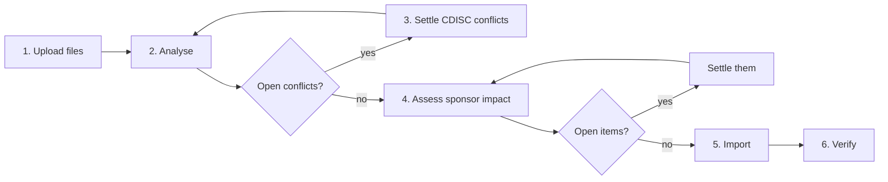

# Import a new CDISC CT package

> **DRAFT** – high-level outline. Screenshots and exact menu labels still to be added/confirmed.

CDISC publishes its controlled terminology (CT) every quarter. This guide describes how to bring a new
release into OpenStudyBuilder (OSB): upload the files from various catalogues, let OSB detect where they disagree, settle
the open points, assess the impact on your sponsor terminology and study data, and finally import the release.

Nothing is written to the OSB library until the very last step. Everything before it happens in a
separate **staging** area, so you can stop, re-upload and start over without any risk to the
existing data.

## Before you start

- You need the **Library.Import** role
- The "Standards Import" feature flag must be **enabled**
- The final import step must be **enabled** by an administrator (*Administration > Standards Import Configuration*).
  It is disabled by default. Uploading, analysing and reviewing work either way.
- Have the files of the release at hand (all sharing the same *effective date*, e.g. `2026-03-27`):
    - one CDISC package file (JSON) per catalogue: SDTM CT, SEND CT, ADaM CT, CDASH CT, ...
    - the *paired view* workbooks (`.xlsx`) published alongside the release (SDTM, SEND, ADaM)
    - optionally, the *terminology changes* spreadsheets (`.xls`)

::: details Fetch the package files automatically from the CDISC Library
The package files can also be fetched using your own CDISC Library API key.
Only SDTM CT & ADaM CT are staged that way; other catalogues must still be uploaded manually.
:::

## The process at a glance

A release moves through these statuses: `FILES_STAGED` → `ANALYZED` (or `BLOCKED` while something is open)
→ `IMPORTED`. Analysis, sponsor impact assessment and import run as background jobs; the page shows
their progress.

.")

## 1. Upload the package files

Create the release by uploading the package file of each catalogue.

- All files must belong to the same effective date; mixed-up files are rejected.
- Every mandatory catalogue must be present before the release can be analysed
  (the list is set in *Standards Import Configuration*).
- Uploading identical content again changes nothing; uploading a changed file replaces the previous one
  and sends the release back to `FILES_STAGED`. If you resolved some findings already in subsequent steps, those are preserved.

Then upload the supporting files:

- **Paired view workbooks** (recommended): they tell OSB which name codelist goes with which code codelist.
  Without them, new codelists are not paired. Make sure the date in the file name matches the release.
- **Terminology changes spreadsheets** (optional): CDISC's own explanation of what changed and why.
  They are shown next to the differences during review and have no effect on the import.

<!-- TODO screenshot: 02_upload_packages.png -->

*Upload packages dialog / task.*

<!-- TODO screenshot: 03_upload_workbooks.png -->

*Supporting files step.*

::: warning
Once a release is `IMPORTED`, no file can be uploaded for it anymore.
:::

## 2. Analyse the release

Start the "CDISC conflicts" analysis. OSB groups all catalogues of the release together and looks for places where
they disagree, for example a different definition for the same codelist in SDTM and ADaM, or stray
quotes around a value.

Most disagreements are settled automatically, using the catalogue priority order and the
resolution rules already stored. Only what cannot be settled automatically is left **open**.

At this step, it also does some automatic necessary transformations:
- Pair code-name codelists together
- Create the sponsor preferred name based on saved rules

When the job has finished, the release is:

- `ANALYZED` – nothing is left open, or
- `BLOCKED` – open conflicts remain and must be settled first.

<!-- TODO screenshot: 04_analysis_result.png -->

*Analysis finished, with counts of total / auto-resolved / open items.*

## 3. Settle the CDISC conflicts

Only needed when the release is `BLOCKED`.

Open the review queue of open items. For each one you see the competing values and which catalogue
supplied each of them. Choose how to settle it, for example:

| Choice | Meaning |
|---|---|
| Prefer a catalogue | Take the value supplied by that catalogue |
| Pick or type a value | Take one of the offered values, or enter your own |
| Strip quotes / rewrite | Clean the value |
| Ignore | Accept the data exactly as CDISC shipped it |

Optionally **save the decision as a rule**, so that the same disagreement is settled automatically
in the next quarterly release. Choose carefully how far the rule should reach (this occurrence only,
this concept, this property for all concepts, or everything of this kind).

Made a mistake? A decision can be taken back, which puts the item back in the queue.

::: warning
Settling an item only **records** the decision. It is applied to the staged values by the next
analysis. Once the queue is empty, **re-analyse the release**. This is safe to repeat; decisions
already taken are kept.
:::

<!-- TODO screenshot: 05_review_queue.png -->

*Queue of open items.*

<!-- TODO screenshot: 06_resolve_dialog.png -->

*Resolution dialog with candidates, strategy and "save as rule" option.*

## 4. Assess the sponsor impact

Once "CDISC conflicts" analysis returns with no open issues, this step becomes available. Entering this step opens the release dashboard, which is your last look at what the release would change
before anything touches OSB. Nothing is written at this point. Then the assessment checks what the release
means for what **your organisation** has already built: the sponsor-defined codelists and terms, and
anything in OSB that refers to a CDISC term. It cannot be skipped; the import refuses a release that has
not been assessed for sponsor impact.

### Review what would change

The dashboard shows how many codelists and terms are new, updated or unchanged, and lets you browse
codelist by codelist and term by term, together with CDISC's own change notes if you uploaded them.
A codelist can be marked as **reviewed** once everything on it has been looked at
(this is a progress aid and does not block the import).

What good looks like for a regular quarterly release:

- a few dozen new codelists and a few hundred new terms,
- a modest number of updated ones,
- **unchanged dominates** by far.

::: danger STOP if thousands of codelists or terms show as updated
It means the staged values do not match how the existing data was written. Nothing has been
written yet, so no harm is done; report it instead.
:::

<!-- TODO screenshot: 08_codelist_review.png -->

*Codelist detail with terms, changes, findings and review status.*

### Settle the sponsor impact findings

It raises review items such as:

- a new CDISC term with the same name as a sponsor term in the same codelist,
- a new CDISC codelist that overlaps a sponsor codelist,
- a CDISC term whose name has changed and the sponsor name no longer matches,
- a CDISC change (new submission value, term removed from a codelist) to a term that is **already used** in OSB.

Items fall in two groups:

- **Open**: must be settled before the import. An exact name collision with a sponsor term is the typical case.
  Keeping both is a valid answer, but it has to be given explicitly (*Acknowledge*). Alternatively the sponsor
  term can be removed from the codelist or retired, but only if nothing refers to it.
- **Informational**: advisory only, never blocking (near-duplicates, overlapping codelists).

<!-- TODO screenshot: 09_sponsor_impact.png -->

*Sponsor impact findings with their tier / status.*

::: warning
If you re-analyse after assessing, you must assess again. The import refuses an assessment
that is older than the last analysis.
:::

## 5. Import

Once nothing is left open and the sponsor impact has been assessed, the **Importing** section lets you
approve the import.

- OSB re-checks the sponsor and usage situation one last time right before starting, and refuses
  if something changed since the assessment (for example a study started using a term you decided to retire).
  Settle the new item and try again.
- The import runs as a background job. When it succeeds, the release is `IMPORTED`.
- If it fails, the error is shown on the job and the release goes back to a state from which the import can be
  retried.

<!-- TODO screenshot: 10_import.png -->

*Approve and import step with job progress.*

## 6. Verify the result

Check the outcome in the application itself:

- the new package appears in the list of CT packages of each catalogue, chained to the previous one;
- the package comparison between the previous and the new effective date lines up with what the
  dashboard announced;
- an updated codelist now has a new version and the previous one is closed at the release date;
  unchanged codelists have exactly one version;
- terms dropped by CDISC are closed in their codelist, not deleted.

<!-- TODO screenshot: 11_ct_packages.png -->

*CT packages page showing the new package.*

## Good to know

- The whole process can be repeated safely until the import: re-uploading, re-analysing and re-assessing
  never touch OSB.
- A release can only be imported once, and a release older than the latest imported cannot be imported.